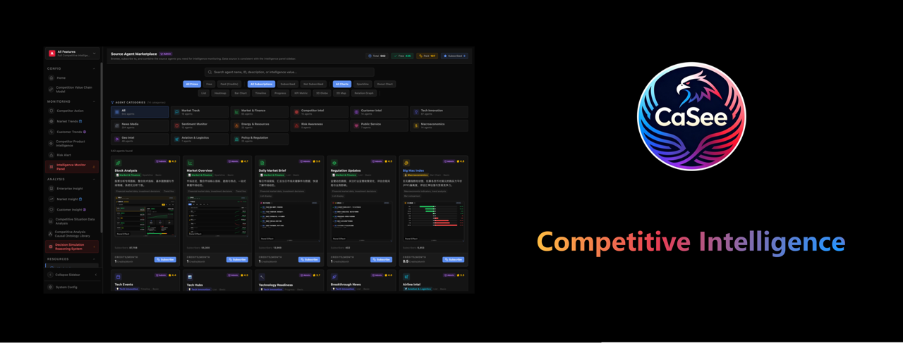
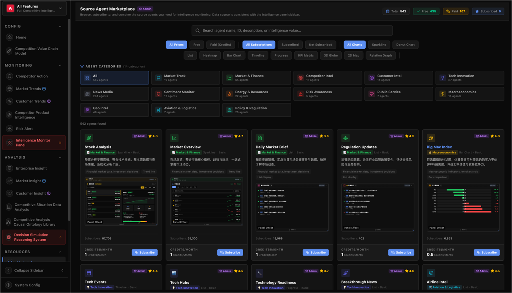
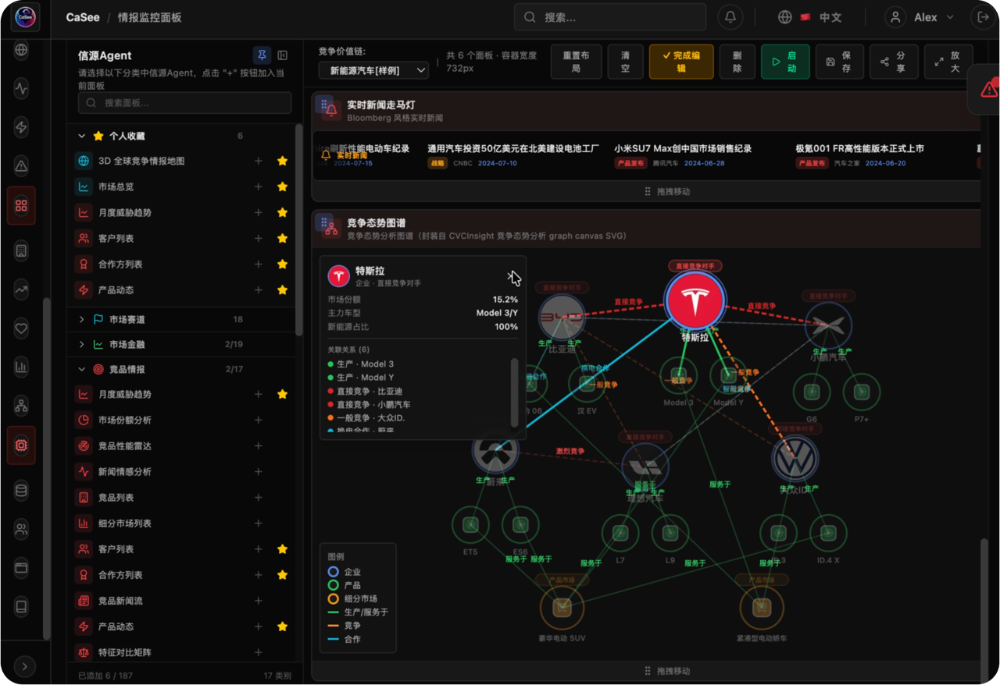
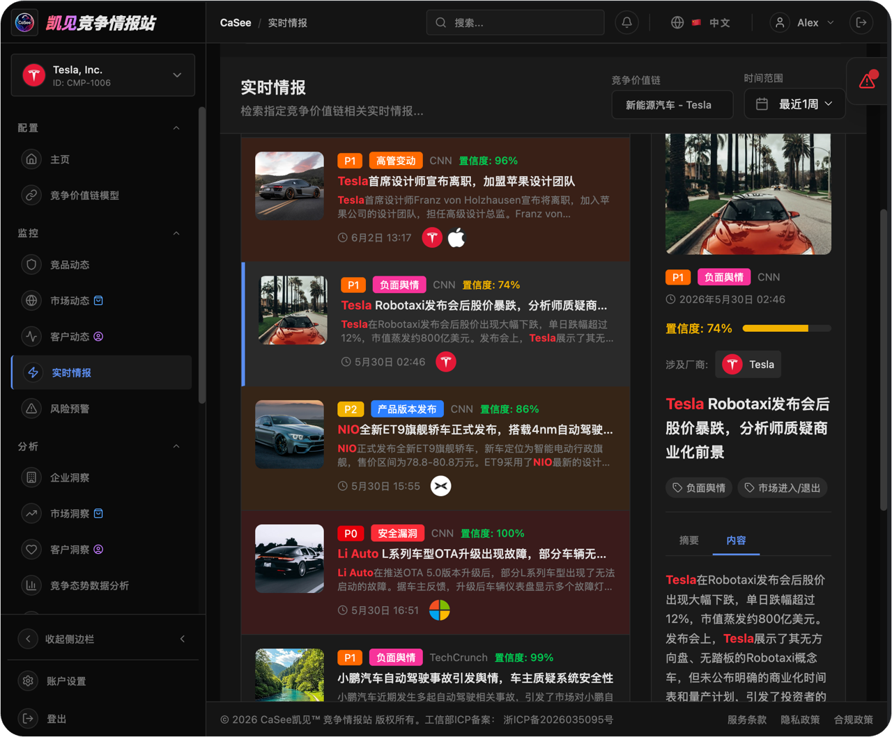
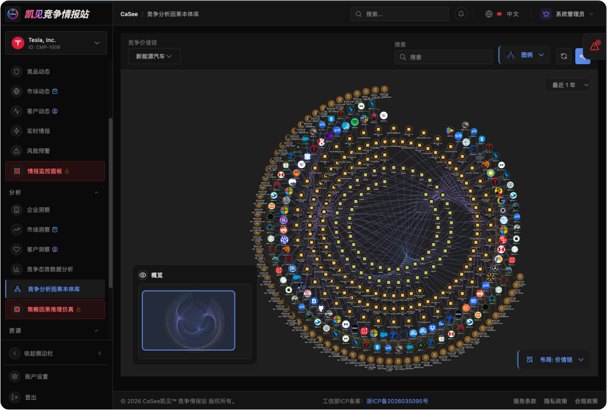

# CaSee Intelligence MCP Server

*Enterprise Competitive Intelligence Retrieval for AI Agents — Built on MCP (Model Context Protocol)*

<p align="center">
  
</p>

<p align="center">
  <a href="https://pypi.org/project/casee-mcp-server/"></a>
  <a href="https://www.python.org/downloads/"></a>
  <a href="LICENSE"></a>
  <a href="https://modelcontextprotocol.io"></a>
</p>

***

## About CaSee — AI-Driven Competitive Intelligence Platform

**CaSee** is an **AI-driven competitive intelligence & market insight platform** — "Win by strategy, sense opportunities first, decide a thousand miles ahead".

CaSee delivers **verifiable competitive intelligence** that helps startups find market opportunities and established enterprises expand their competitive advantages. It solves the core pain points of enterprise competitive intelligence:

- Fragmented intelligence collection
- Inefficient manual analysis
- Outdated market insights
- Intelligence that never reaches business decisions

Built for market, sales, product, and strategy teams of mid-to-large enterprises, CaSee connects market data with business decision-making — upgrading from **passive competitive monitoring** to **proactive market trend prediction**.

### Platform Capabilities

| Capability                                 | Description                                                                                                                                                                                                                 |
| ------------------------------------------ | --------------------------------------------------------------------------------------------------------------------------------------------------------------------------------------------------------------------------- |
| **Real-time Competitive Sensing**          | Monitor competitors, markets, and customers for specific business lines; panoramic external environment scanning; real-time threat alerts with tiered control                                                               |
| **Quantified Competitive Threat Analysis** | SWOT, PESTEL, BCG Matrix, VRIO Framework and other systematic analysis tools to evaluate industry profitability, competitive landscape, and policy risks                                                                    |
| **Proactive Strategy Evaluation**          | Proprietary Neural-Causal AI long-chain causal reasoning engine predicts the effects of competitive strategies — open-world reasoning for long-chain causal links, closed-world reasoning for quantified execution outcomes |
| **Trusted Intelligence Collection**        | Real-time competitor tracking, market trend prediction, fusion of fragmented intelligence, goal-oriented targeted intelligence sensing                                                                                      |
| **Expert Competitive Analysis**            | Customized CI analysis capability building, self-service professional reports, and an industry expert knowledge base                                                                                                        |

> **Trusted Intelligence Assurance**: Quantified T-Score credibility scoring, multi-source cross-validation, causal-reasoning bias detection, and compliance guardrails prevent AI agent hallucination, stale data, and false citations.

> **Try CaSee**: <https://casee.me> — get your API key and explore the platform.


<p align="center">
  
</p>

***

## 🎯 What is casee-mcp-server?

casee-mcp-server is the **MCP (Model Context Protocol) gateway** that exposes CaSee's competitive intelligence retrieval capabilities as standardized MCP Tools for AI Agents (WorkBuddy, Trae Work, Claude Desktop, LangChain, CrewAI, and any MCP-compatible framework).

It bridges two worlds:

- **CaSee's intelligence backend** — curated intelligence with T-Score credibility, real-time competitive dynamics, and quantified analysis
- **Your AI Agent** — any LLM application that speaks MCP (stdio or Streamable-HTTP)

With casee-mcp-server, your AI agents gain **real-time, credibility-scored intelligence retrieval** from the CaSee platform — turning them from generic chat tools into verifiable competitive intelligence analysts that can run complex logic retrieval, analyze trends, and aggregate by category / region / language — all through a compact set of MCP tools.

***

<p align="center">
  
</p>


## 🤖 Why casee-mcp-server?

LLM AI Agents (Claude, GPT, etc.) can generate competitive intelligence reports, but their analysis is **limited by training data cutoff dates** and **unverifiable sources**. When you ask an LLM directly about "global EV battery market trends," you get:

- Outdated information (trained months ago)
- Unverifiable sources (hallucinated or unknown provenance)
- Shallow analysis (lacks industry-specific frameworks)

**casee-mcp-server** bridges this gap by giving AI Agents access to **real-time, credibility-scored intelligence retrieval**:

| Dimension           | LLM Alone              | With casee-mcp-server                                          |
| ------------------- | ---------------------- | -------------------------------------------------------------- |
| **Source Trust**    | Unknown / hallucinated | Curated intelligence with tscore (0-1) credibility scoring     |
| **Data Freshness**  | Training cutoff date   | Real-time, configurable time window (1-365 days)               |
| **Query Precision** | Natural language only  | Search-engine syntax: `+AND` / `-NOT` / `"phrase"` / `(groups)` |
| **Analysis Depth**  | Surface-level summary  | Trend analysis + category / region / language aggregation      |
| **Traceability**    | None                   | Every result links to specific source, date, and tscore        |

> **Core Value**: Transforms AI Agents from "chat tools" into **trusted competitive intelligence analysis systems** — with timely, traceable, and quantifiable intelligence.

***

## 🧭 Agent Quick Decision Tree

Most agents stop at free keyword search. CaSee's higher-value capabilities (CVC modelling → semantic search → insight → report) are invisible at that decision point, so the server ships two **free, local** guidance tools and every tool advertises its cost tier in `_meta.tier`:

| Tier | Meaning | Tools |
| --- | --- | --- |
| **T0** | Free, instant — call without asking | `search_intelligence`, `casee_home_overview`, `casee_get_credits`, `casee_get_cvc_dashboard`, `casee_get_market_trends`, `list_report_templates`, `casee_list_cvc_companies` |
| **T1** | Free add-on analysis | `analyze_trend`, `aggregate_intelligence`, `search_with_cvc`, `casee_search_charts`, `plan_report` |
| **T2** | **Ask first** — costs 0.5–2.5 credits, 8 s – 10 min | `create_cvc_model` (default lite: 1.0 credit ≈3-5 min; full: 2.5 credits ≈10 min), `rebuild_cvc_model`, the three `*_insight` tools, `generate_report` |
| **T3** | Destructive — confirm twice | `rebuild_cvc_model`, `intelligence_purge_tool`, `cvc_cache_purge_tool` |

Routing rules (same content as `casee_guide`):

| If the user… | Then call |
| --- | --- |
| only wants the latest news / one-off Q&A | `search_intelligence` (free) |
| wants ongoing tracking, cross-time comparison, competitor watch | build a CVC: `search_cvc_companies` → `create_cvc_model` → `rebuild_cvc_model` |
| already has a CVC and wants evidence by meaning | `search_with_cvc` (collect) → `semantic_search_tool` (retrieve) |
| wants to see the result before paying for a build | open the public read-only sample `cvc_demoevbat01` (0 credit): `casee_get_cvc_dashboard` → insights; then create your own lite CVC |
| asks whether a company is worth partnering with / risky / behind | `casee_get_enterprise_insight` (0.5 credit, `dry_run=true` first) |
| asks about market size, drivers, opportunities | `casee_get_market_trends` (free) → `casee_get_market_insight` if explanation is needed |
| wants to know what their own customers think | `casee_get_customer_insight` (needs `cvc_id` + module access) |
| wants a report / deck / chart | `list_report_templates` → `plan_report` → `generate_report` |

**Hard rules the server enforces or recommends**

1. Anything paid or slower than 30 s: state `cost_credits` / `eta_seconds` and wait for the user's confirmation.
2. `company_name` must come from `casee_list_cvc_companies` — never invent it.
3. Treat `recommendations` / `next_actions` in responses as authoritative next steps.
4. On `PRODUCT_ACCESS_DENIED`, `SCOPE_DENIED_WRITE` (writing to a public / template read-only sample), zero results, or degraded semantic search, follow the `alternatives` array instead of retrying silently.
5. CVC builds are async: poll at most 3 times per turn, then hand off to `get_cvc_build_status` / the completion email.
6. CVC builds have two profiles — `build_profile="lite"` (default, 1.0 credit, ETA ~300 s) and `"full"` (2.5 credits, ~600 s); the first CVC is free. Start with lite, escalate with `rebuild_cvc_model(build_profile="full")` only when needed.

Two entry tools make this executable without reading 62 tool descriptions:

- `casee_guide(topic="")` — one-screen manual: tiers, decision tree, naming synonyms (`价值链` / `CVC` / `价值链检索` → which tool), free vs. paid, first-run checklist.
- `casee_plan_task(goal, cvc_id="", budget_credits=0, max_wait_seconds=60)` — turns a natural-language goal into 2–3 options with cost, ETA, prerequisites and an `ask_user` sentence to relay verbatim. Always includes a 0-credit option.

### WorkBuddy host prompt (copy-paste)

Paste this into the agent's system prompt / persona so it routes correctly on the first turn:

```text
你已连接 CaSee 竞争情报 MCP（casee，62 个工具）。
1) 用户提出目标但没指定能力时，先调用 casee_plan_task(goal=<用户原话>)，并原样转述 ask_user，让用户在 A/B/C 中选。
2) 用户问「能做什么 / 怎么用」，或用了「价值链 / CVC / 深度研判 / 行业趋势」等别名时，先调用 casee_guide() 对齐能力与工具名。
3) 任何收费（>0 credit）或预计超过 30 秒的操作，先说明 cost_credits / eta_seconds 并等待确认。
4) 用户想「持续跟踪 / 盯住 / 每周对比」时，不要只做一次检索：按 search_cvc_companies → create_cvc_model → rebuild_cvc_model 建链（约 10 分钟，完成后邮件通知）。
5) 工具返回 recommendations / alternatives 时优先采用；遇到 PRODUCT_ACCESS_DENIED 或 0 结果，按 alternatives 给出替代路径，不要静默重试。
6) 引用情报时保留 tscore 与日期，说明数据缺口，不要编造来源。
```

***

## 🚀 Quick Start

There are **two ways** to use casee-mcp-server:

| Option | Description | Best For |
|--------|-------------|----------|
| **A. Self-hosted MCP** | Build & run `casee-mcp-server` yourself (pip / source / Docker) | Full control, air-gapped networks, custom tuning, stdio mode |
| **B. Hosted MCP (zero-setup)** | Connect directly to the deployed server at `https://causalai.me:8100/mcp` | Fastest time-to-value, no local install |

### Prerequisites

- **Python 3.10+** (only required for Option A)
- **A CaSee API Key** ([get one at https://casee.me](https://casee.me)) — required for both options; every intelligence request is authenticated with it

---

### Option A — Build & Run Your Own MCP Server

#### Step 1: Get a CaSee API Key

Register at [https://casee.me](https://casee.me) and create a **read-only API key** for your agent (we recommend scoping it to `intelligence:read`). Keep it secret — it authenticates every request.

#### Step 2: Install

```bash
# From PyPI
pip install casee-mcp-server

# Or from source
git clone https://github.com/xcasee/casee-mcp-server.git
cd casee-mcp-server && pip install -e .
```

#### Step 3: Configure environment variables

```bash
export CASEE_IS_API_KEY=casee_xxx                          # your CaSee API key (casee.me)
export CASEE_API_BASE_URL=https://casee.me # CaSee Intelligence Server URL
export CASEE_OPENAPI_BASE_URL=https://origin.casee.me/api/v1/openapi  # direct origin, bypass CDN
export CASEE_PORTAL_BASE_URL=https://www.casee.me
```

#### Step 4: Start the server

**stdio mode** — for Claude Desktop and local tools (a local process, one connection):

```bash
casee-mcp
```

**Streamable-HTTP mode** — for WorkBuddy / Trae Work / remote agents (exposes a single HTTP endpoint):

```bash
casee-mcp --http --port 8100
```

The server listens on `http://127.0.0.1:8100/mcp` by default. To expose it on the network, set `MCP_HOST=0.0.0.0`.

#### Step 5: Verify the server is alive

```bash
curl -X POST http://localhost:8100/mcp \
  -H "Content-Type: application/json" \
  -H "Accept: application/json, text/event-stream" \
  -d '{"jsonrpc":"2.0","id":1,"method":"initialize","params":{"protocolVersion":"2025-03-26","capabilities":{},"clientInfo":{"name":"test","version":"1.0"}}}'
```

You should receive an `initialize` result with `serverInfo.name == "casee"`. Then list the tools:

```bash
# after initialize, get the session id from the response header "Mcp-Session-Id"
curl -X POST http://localhost:8100/mcp \
  -H "Content-Type: application/json" \
  -H "Accept: application/json, text/event-stream" \
  -H "Mcp-Session-Id: <your-session-id>" \
  -d '{"jsonrpc":"2.0","id":2,"method":"tools/list","params":{}}'
```

You should see all **62 tools**: the 5 query tools (`search_intelligence`, `analyze_trend`, `aggregate_intelligence`, `semantic_search_tool`, `search_with_cvc`) plus `batch_search`, CVC administration tools, full-history purge, the v1.4 report tools (templates / plan / generate / poll / share / rebuild / health), the v1.6 CVC creation tools (company search / create / job polling / build status) and the v1.7 OpenAPI coverage tools (credits / ledger / quota, report download, charts, template CRUD, CVC inspection and business insights).

#### Step 6: Run with Docker (recommended for production)

```bash
# 1. configure your API key
echo "CASEE_IS_API_KEY=casee_xxx" > .env

# 2. build & start
docker compose -f docker/docker-compose.yml up -d

# 3. check status
docker compose -f docker/docker-compose.yml ps
```

---

### Option B — Connect to the Hosted MCP Server

No installation needed. The server is already deployed and running:

```
MCP endpoint : https://causalai.me:8100/mcp
Transport    : Streamable-HTTP
Server       : casee (62 MCP tools)
Backend      : CaSee Intelligence Server (auto-resolved)
```

Just grab your `CASEE_IS_API_KEY` from [https://casee.me](https://casee.me) and plug the URL into your AI agent. Jump straight to [Platform Integrations](#-platform-integrations) for the per-platform walkthrough — no Python, no Docker required.

> **Tip**: For a quick sanity check before wiring a client, run the bundled test suite against the hosted endpoint:
>
> ```bash
> python tests/test_mcp_server.py --url https://causalai.me:8100/mcp
> ```

***

## 🧰 MCP Tools

The server exposes **62 MCP Tools** for AI Agents: retrieval, CVC administration, CVC creation and end-to-end report generation — plus the two UX entry tools `casee_guide` / `casee_plan_task`.

| Tool                          | Description                                                           | Key Parameters                                         |
| ----------------------------- | --------------------------------------------------------------------- | ------------------------------------------------------ |
| `search_intelligence`         | Complex logic retrieval: AND/OR/NOT/phrase/synonym groups             | `q` (query syntax), `min_tscore`, `days`               |
| `analyze_trend`               | Time-series trend analysis of intelligence volume                     | `q`, `days`                                            |
| `aggregate_intelligence`      | Aggregate results by `category` / `region` / `language`               | `q`, `dimension`, `days`                               |
| `semantic_search_tool`        | Semantic search via CVC model: BM25 + Vector ANN + RRF fusion         | `cvc_model_id`, `q`, `mode`, `top_k`, `days`, `min_tscore` |
| `search_with_cvc`             | Keyword search with optional CVC model sync for semantic index        | `q`, `cvc_model_id`, `min_tscore`, `days`              |
| `batch_search`                | Server-side batch search: many advanced queries in one round-trip     | `groups`, `dedupe`, `max_concurrency`                  |
| `list_cvc_models_tool`        | List all CVC models with collection statistics                        | —                                                      |
| `cvc_stats_tool`              | Collection statistics for a CVC model                                 | `cvc_model_id`                                         |
| `cvc_cache_purge_tool`        | Reset a CVC cache (clear three-store collection data)                 | `cvc_model_id`                                         |
| `cvc_cleanup_status_tool`     | Cleanup progress + three-store residual reconciliation                | `cvc_model_id`                                         |
| `cvc_reindex_tool`            | Replay collection audit to rebuild a CVC store                        | `cvc_model_id`                                         |
| `intelligence_purge_tool`     | Full-history intelligence purge by time cutoff (dry-run supported)    | `older_than_days`, `end_date`, `dry_run`, `include_mongodb` |
| `intelligence_purge_status_tool` | Full-history purge progress + residual reconciliation              | `task_id`                                              |

> **v1.2.0 (2026-09-12):** added `batch_search` plus CVC administration tools
> (`list_cvc_models_tool` / `cvc_stats_tool` / `cvc_cache_purge_tool` /
> `cvc_cleanup_status_tool` / `cvc_reindex_tool`), and full-history purge
> (`intelligence_purge_tool` / `intelligence_purge_status_tool`), powered by the
> upgraded `casee` SDK **1.9.0**.
>
> **v1.12.0 (2026-11-25):** agent UX layer — added `casee_guide` and
> `casee_plan_task` (free, local, no backend call) so agents route from user
> intent instead of guessing among 62 tool names; every tool advertises
> `_meta.tier` (T0–T3) plus cost/latency hints; responses carry at most three
> de-duplicated `recommendations` (`tool` + `args` + `cost_credits` +
> `eta_seconds`); structured errors include an `alternatives` array;
> `CvcModelId` is validated inside the tool (structured `VALIDATION_ERROR`)
> instead of by a JSON-Schema `pattern`, so bad ids stay renderable for the
> agent. Backend adds `GET /api/v1/openapi/admin/usage-summary` and
> client / session attribution for MCP traffic.
>
> **v1.13.0 (2026-11-25):** CVC build profiles & zero-cost trial — `create_cvc_model`
> and `rebuild_cvc_model` accept `build_profile="lite"` (default, 1.0 credit,
> ETA ~300 s) or `"full"` (2.5 credits, ~600 s); the first CVC build stays free.
> Added the public read-only sample `cvc_demoevbat01` (owner `demo_public`) for
> 0-credit dashboard / insight demos, with `visibility` / `is_read_only` /
> `owner_tenant_id` / `access_role` / `build_profile` / `eta_seconds` /
> `quality_status` surfaced by `get_cvc_build_status` and `casee_get_cvc_model`;
> writes against public samples return `SCOPE_DENIED_WRITE` with an `alternatives`
> path to create your own lite CVC. Insight tools support free `dry_run=true`
> pre-checks; `casee_plan_task` now defaults `max_wait_seconds=600`.
>
> **v1.10.0 (2026-11-17):** public-surface hardening — added `sanitize.py`
> response projection applied at both tool exits (opaque `source_id`, no
> source catalogs / `top_sources` lists, Google News collection-channel
> fingerprints normalized to `公开媒体` / `public_news`); pinned `casee` SDK
> wheel upgraded to **2.0.0** (source-enumeration and gnews client helpers
> removed upstream).
>
> **v1.7.1 (2026-11-13):** ledger audit fixes — `direction=refund|charge|grant`
> filtering, `older_cursor` alias, page-based paging and `summary.refunded_count`
> over the full history; `billing.ledger_query` now points at the matching
> ledger direction.
>
> **v1.7.0 (2026-11-12):** full `/api/v1/openapi` coverage — added credits /
> ledger / quota tools, `casee_download_report` (+ the `TEMPLATE_TOO_LARGE` 413
> fallback), chart catalog / preview / bundle, report template CRUD, CVC
> inspection (entities / ontology / intelligence / exports) and business
> insights. Large artifacts are saved to `CASEE_DOWNLOAD_DIR`.
>
> **v1.6.0 (2026-11-02):** CVC creation tools now use async job endpoints
> (`/companies/search-jobs` / `/cvc-models/creation-jobs`) with a bounded
> `wait_seconds`; added `get_company_search_job` / `get_cvc_creation_job` for
> job polling when the wait budget is exhausted.

### Report tools (v1.4)

| Tool | Description | Key Parameters |
| --- | --- | --- |
| `list_report_templates` | List system + tenant report templates | `scope`, `q`, `page`, `page_size` |
| `plan_report` | Pre-flight: sections, charts, gaps, compatibility, credits | `cvc_id`, `template_id`, `time_range`, `language` |
| `generate_report` | Create an async report job (1 Credit) | `cvc_id`, `template_id`, `output_formats`, `idempotency_key` |
| `get_report_job` | Poll status, quality, artifacts and share link | `job_id`, `wait_ms` |
| `list_report_jobs` | Paginated job history | `cvc_id`, `status`, `page`, `page_size` |
| `share_report` | Create a password-free `rs-` share snapshot | `job_id`, `ttl_seconds` |
| `backup_cvc_intelligence` | Export metadata (count / ETag) before a rebuild | `cvc_id` |
| `rebuild_cvc_model` | Destructive rebuild; dry-run by default, `confirm=true` to execute; switch profile via `build_profile` | `cvc_id`, `confirm`, `backup`, `dry_run`, `build_profile` |
| `casee_health` | Gateway/backend version, API base, Credits balance | — |

Successful report tools return `{ok: true, data, meta}` where `meta` carries
`elapsed_ms`, `request_id` (when available) and `next_poll_after_ms`.
Failures keep the structured error fields below plus `ok: false`.

### CVC creation tools (v1.6)

| Tool | Description | Key Parameters |
| --- | --- | --- |
| `search_cvc_companies` | Search candidate companies for an analysis goal; creates an async job and polls up to `wait_seconds`; returns proposed products/markets/competitors and `selected=true` (all by default) | `query`, `language`, `limit`, `wait_seconds` |
| `create_cvc_model` | Create a CVC draft (company names or objects) via an async job; returns `build_readiness`, `warnings`, `build_profile` and `next_step` | `name`, `companies`, `query_topic`, `query_type`, `build_profile` (`lite`/`full`), `overwrite`, `idempotency_key`, `wait_seconds` |
| `get_company_search_job` | Poll a company-search job by `job_id`; `result` matches the synchronous search payload when succeeded | `job_id` |
| `get_cvc_creation_job` | Poll a CVC-creation job by `job_id`; `result` contains `cvc_id` / `build_readiness` when succeeded | `job_id` |
| `get_cvc_build_status` | Phase progress, current step, failure attribution and polling hints; also returns `visibility` / `is_read_only` / `owner_tenant_id` / `access_role` / `build_profile` / `eta_seconds` / `quality_status`; supports long-poll and incremental logs | `cvc_id`, `wait_seconds`, `include_logs`, `log_since` |

> Flow: `search_cvc_companies` (show the list, all selected by default) →
> `create_cvc_model(build_profile="lite")` → `rebuild_cvc_model(confirm=true, dry_run=false)` →
> tell the user "lite takes ~3-5 min (full ~10 min); a completion email will be sent" and do **not** block.
> Both creation tools use the async job endpoints and return a `job_id` when the
> wait budget is exhausted; continue with `get_company_search_job` /
> `get_cvc_creation_job`. When the user asks later, call `get_cvc_build_status`
> and report `phases[]` / `failure.hint`.
>
> **Zero-cost trial before spending:** the public read-only sample
> `cvc_demoevbat01` (owner tenant `demo_public`, `visibility=public`,
> `is_read_only=true`) is open to every API key at 0 credits — call
> `casee_get_cvc_dashboard`, `search_with_cvc` or the insight tools against it to
> show what a finished CVC looks like. Write operations on it return
> `SCOPE_DENIED_WRITE` with `alternatives: [create your own lite CVC]`.

### OpenAPI coverage tools (v1.7)

v1.7 closes the remaining `/api/v1/openapi` gaps, so agents no longer need to
call the REST API directly for billing, artifacts, charts, templates or CVC
inspection.

**Billing & quota**

| Tool | Description | Key Parameters |
| --- | --- | --- |
| `casee_get_credits` | Balance (three buckets), pending reservations, `ledger_cursor`, per-operation prices; no charge | — |
| `casee_get_credit_ledger` | Ledger reconciliation (reserve/confirm/refund) with `direction=refund`, `page`, `cursor`/`older_cursor` or `since_id` paging; `summary.refunded_count` covers the full history | `operation`, `status`, `direction`, `job_id`, `cvc_id`, `page`, `cursor`/`older_cursor`, `since_id`, `page_size` (max 500) |
| `casee_get_quota` | Key scopes, minute/day quota watermarks, accessible model count, product access | — |

**Report artifacts & templates**

| Tool | Description | Key Parameters |
| --- | --- | --- |
| `casee_download_report` | Download HTML/Markdown/PPT(deck) to disk; returns `saved_path` / `sha256` / `bytes` (optional inline) | `job_id`, `format`, `save_path`, `inline` |
| `casee_issue_report_access_code` | One-time report generation code for keyless web pages | `cvc_id`, `template_id`, `time_range`, `output_formats`, `ttl_seconds` |
| `casee_get_report_template` | Template detail: sections, per-section `ca_code`, writing constraints | `template_id` |
| `casee_download_report_template` | Export a template as Markdown (fork → edit → upload) | `template_id`, `save_path` |
| `casee_create_report_template` | Upload a tenant template after validation | `template_id`, `name`, `content_md`, `summary`, `status` |
| `casee_update_report_template` | Update a tenant template (system templates are read-only) | `template_id`, `name`/`content_md`/`summary`/`status` |
| `casee_delete_report_template` | Soft-delete a tenant template (`confirm=true` required) | `template_id`, `confirm` |
| `casee_validate_report_template` | Validate without saving; returns per-error codes | `template_id`, `content_md` |

> **413 fallback:** when `share_report` returns `error_code=TEMPLATE_TOO_LARGE`
> (HTTP 413), do not retry. `details.fallback_tool` points to
> `casee_download_report`; download and distribute the file instead.

**Charts**

| Tool | Description | Key Parameters |
| --- | --- | --- |
| `casee_search_charts` | Chart capability dictionary; pass `cvc_id` for per-chart availability | `domain`, `function_category`, `q`, `cvc_id`, `time_range`, `detail` |
| `casee_get_chart` | Chart detail and field contract | `ca_code`, `cvc_id`, `time_range` |
| `casee_preview_chart` | Preview render bundle (no report quota) | `ca_code`, `cvc_id`, `include_embed`, `save_path` |
| `casee_get_chart_bundle` | Issue a `cc-` code and fetch the bundle in one step (or reuse `code`) | `code`, `cvc_id`, `chart`, `ttl_seconds`, `include_embed` |

**CVC inspection & business insights**

| Tool | Description | Key Parameters |
| --- | --- | --- |
| `casee_home_overview` | Tenant overview: model status, building jobs, recent reports, credits | `limit` |
| `casee_get_cvc_model` | Model metadata, graph stats and entity collections | `cvc_id`, `include`, `detail`, `expand` |
| `casee_list_cvc_companies` | Company list with roles, websites and selected entities | `cvc_id` |
| `casee_list_cvc_entities` | Paged ontology entity list | `cvc_id`, `entity_type`, `keyword`, `company`, `page` |
| `casee_get_cvc_entity` | Entity attributes, relations, IRI and related intel | `cvc_id`, `entity_type`, `entity_id`, `by` |
| `casee_get_ontology_schema` | Ontology TBox (classes / properties) | `cvc_id` |
| `casee_export_ontology` | Export an entity/keyword subgraph as OWL 2 DL (≤200 triples) | `cvc_id`, `entity_type`, `entity_id`, `keyword`, `format`, `include` |
| `casee_search_cvc_intelligence` | Search intelligence inside a CVC (keywords/sentiment/time/company) | `cvc_id`, `keywords`, `match`, `sentiment`, `days`, `page` |
| `casee_get_intelligence_detail` | One intelligence item plus matched entities | `cvc_id`, `intel_id` |
| `casee_export_intelligence` | Export all intelligence to JSONL/JSON on disk (pre-rebuild backup) | `cvc_id`, `format`, `save_path` |
| `casee_get_cvc_dashboard` | Business dashboard (volume/sentiment/voice/events; no credits) | `cvc_id`, `time_range` |
| `casee_get_market_trends` | Market trends (heat/sources/topics) | `cvc_id`, `time_range` |
| `casee_get_enterprise_insight` | Enterprise insight; `dry_run=true` by default (probe only) | `cvc_id`, `company_name`, `dry_run` |
| `casee_get_market_insight` | Market insight; `dry_run=true` by default | `cvc_id`, `market_name`, `dry_run` |
| `casee_get_customer_insight` | Customer insight; `dry_run=true` by default | `cvc_id`, `customer_name`, `dry_run` |

**Discovery**

| Tool | Description | Key Parameters |
| --- | --- | --- |
| `casee_list_endpoints` | Endpoint catalog (group / keyword / full parameter tables) | `group`, `q`, `detail` |
| `casee_get_endpoint` | One endpoint's parameters, error codes and changelog | `endpoint_id` |
| `casee_list_mcp_tools` | Backend-declared MCP tools/resources/prompts snapshot | — |

> Large artifacts (report HTML, intelligence export, OWL) are written to
> `CASEE_DOWNLOAD_DIR` (default: `casee-downloads` under the system temp dir)
> and returned with `saved_path`, `bytes` and `sha256`; pass `inline=true`
> (plus `max_inline_chars`) to also receive the content.

### MCP prompts (v1.6)

`prompts/list` exposes three reusable recipes:

- `cvc_creation` — company search → user confirms (all by default) → create → build → 10 min/email
- `report_generation` — templates → plan → generate → poll → share → quality statement
- `retrieval_quality_guard` — degraded semantic search / zero-result disclosure rules

### Retrieval Workflow (Scope-First, Keyword Search)

```
┌────────────────────────────────────────────────────────────────┐
│  Stage 1: Describe the query and the scope                      │
│  q="+EV +(battery|charging) -China"                             │
│  scope: category / region / language, min_tscore, days           │
└──────────────────────────┬─────────────────────────────────────┘
                           │
                           ▼
┌────────────────────────────────────────────────────────────────┐
│  Stage 2: search_intelligence(                                  │
│      q="+EV +(battery|charging) -China",                        │
│      min_tscore=0.6, days=30                                    │
│  )                                                              │
│  → Returns: verified, high-quality intelligence results         │
│  → Follow up with analyze_trend / aggregate_intelligence        │
└────────────────────────────────────────────────────────────────┘
```

### Semantic Search Workflow (CVC Model)

For scenarios requiring deeper semantic understanding (e.g., competitor analysis, market trend discovery, customer needs analysis), CaSee provides a **Competitive Value Chain (CVC)** based semantic search workflow:

```
┌────────────────────────────────────────────────────────────────────────┐
│  Step 1: Build CVC Model (one-time setup)                              │
│  • Collect intelligence items via search_with_cvc(cvc_model_id="...")  │
│  • System automatically indexes items into Qdrant vector database      │
│  • CVC model becomes ready for semantic search                          │
└──────────────────────────┬─────────────────────────────────────────────┘
                           │
                           ▼
┌────────────────────────────────────────────────────────────────────────┐
│  Step 2: Semantic Search                                              │
│  semantic_search_tool(                                                │
│      cvc_model_id="cvc_abc12345",                                     │
│      q="竞争对手最新AI芯片技术突破",                                     │
│      mode="hybrid",        # hybrid | semantic | keyword              │
│      top_k=20,                                                       │
│      days=30,                                                        │
│      min_tscore=0.5                                                  │
│  )                                                                    │
│  → Returns: semantically matched results with fusion scores           │
└────────────────────────────────────────────────────────────────────────┘
```

#### Semantic Search Modes

| Mode | Description | Use Case |
|------|-------------|----------|
| `hybrid` (default) | Combines BM25 keyword matching + vector similarity + RRF fusion | Best general-purpose search, balances precision and recall |
| `semantic` | Vector similarity search only | Finding conceptually related intelligence across different terminologies |
| `keyword` | BM25 keyword matching only | Exact term matching, faster response |

#### CVC Model ID Format

CVC model IDs follow the pattern `cvc_[a-z0-9]{8,32}`:
- Must start with `cvc_` prefix
- Followed by 8-32 lowercase alphanumeric characters
- Example: `cvc_abc12345`, `cvc_market_intel_2024`

***

## 🔌 Platform Integrations

Below are **step-by-step walkthroughs** for wiring casee-mcp-server into each platform. Every example works with either:

- **Option A** — your self-hosted server (stdio or `http://127.0.0.1:8100/mcp`)
- **Option B** — the hosted endpoint `https://causalai.me:8100/mcp`

> Replace `casee_xxx` with your real key from [https://casee.me](https://casee.me), and replace `https://causalai.me:8100/mcp` with your own URL if you self-host.

---

### 1. Claude Desktop

Claude Desktop launches MCP servers as **local stdio processes**, so it works best with **Option A** (or the `url`-based config below on newer versions).

#### Step 1: Install the server locally

```bash
pip install casee-mcp-server
```

#### Step 2: Open the Claude Desktop config file

- **macOS**: `~/Library/Application Support/Claude/claude_desktop_config.json`
- **Windows**: `%APPDATA%\Claude\claude_desktop_config.json`

If the file does not exist, create it.

#### Step 3: Add the `casee-intelligence` server

```json
{
  "mcpServers": {
    "casee-intelligence": {
      "command": "casee-mcp",
      "env": {
        "CASEE_IS_API_KEY": "casee_xxx",
        "CASEE_API_BASE_URL": "https://casee.me",
        "CASEE_OPENAPI_BASE_URL": "https://origin.casee.me/api/v1/openapi"
      }
    }
  }
}
```

#### Step 4: Restart Claude Desktop

Fully quit (Cmd+Q / Alt+F4) and relaunch Claude Desktop so it re-reads the config and spawns the server.

#### Step 5: Verify the tools

Click the **tools (hammer) icon** next to the composer input. You should see `casee-intelligence` with its **62 tools** (the 5 query tools `search_intelligence`, `analyze_trend`, `aggregate_intelligence`, `semantic_search_tool`, `search_with_cvc`, plus batch search, CVC admin/purge, report tools and CVC creation tools).

#### Step 6: Try it

Ask Claude:

> *"Use the casee tools to search for the latest Nvidia competitive intelligence, then summarize the key findings with their credibility scores."*

Claude will call `search_intelligence` and answer with traceable items and tscore values.

> **Alternative — connect to the hosted endpoint (newer Claude Desktop versions)**:
>
> ```json
> {
>   "mcpServers": {
>     "casee-intelligence": {
>       "url": "https://causalai.me:8100/mcp",
>       "headers": { "X-API-Key": "casee_xxx" }
>     }
>   }
> }
> ```

---

### 2. WorkBuddy

WorkBuddy connects to MCP servers over **Streamable-HTTP** — ideal for the hosted endpoint (Option B) or your self-hosted server exposed on the network.

#### Step 1: Locate (or create) the WorkBuddy MCP config file

WorkBuddy registers MCP servers through the user-level config file:

```
.workbuddy/mcp.json
```

By convention, this file lives at the user's home directory (`~/.workbuddy/mcp.json` on macOS/Linux, `%USERPROFILE%\.workbuddy\mcp.json` on Windows). If it does not exist, create it.

#### Step 2: Add the `casee-intelligence` server

Edit `.workbuddy/mcp.json` and add an entry under `mcpServers`:

```json
{
  "mcpServers": {
    "casee-intelligence": {
      "transport": "streamable-http",
      "url": "https://causalai.me:8100/mcp",
      "headers": {
        "X-API-Key": "casee_xxx"
      }
    }
  }
}
```

Field reference:

| Field | Value | Required | Description |
|-------|-------|----------|-------------|
| `transport` | `streamable-http` | Yes | MCP transport type |
| `url` | `https://causalai.me:8100/mcp` | Yes | MCP endpoint (replace with your self-hosted URL if needed) |
| `headers.X-API-Key` | `casee_xxx` | Yes | Your CaSee API key from [casee.me](https://casee.me) |

> **Note**: The `X-API-Key` header is what WorkBuddy will forward on every MCP request so the upstream casee-mcp-server can authenticate against the CaSee Intelligence backend. If you also need to override the backend URL, set it as an environment variable on the **server side** (e.g. in the Docker container's env), not in this client config.

#### Step 3: Save the file and reload WorkBuddy

Save `.workbuddy/mcp.json`, then trigger a config reload in WorkBuddy (typically `Cmd/Ctrl+R` in the MCP panel, or restart the WorkBuddy desktop app).

#### Step 4: Verify the tools

Open the MCP tool panel. You should see `casee-intelligence` with its **62 tools** (the 5 query tools `search_intelligence`, `analyze_trend`, `aggregate_intelligence`, `semantic_search_tool`, `search_with_cvc`, plus batch search, CVC admin/purge, report tools and CVC creation tools).

#### Step 5: Try it

Ask WorkBuddy:

> *"Track the latest EV battery competition signals."*

WorkBuddy will call `search_intelligence` and answer with traceable items and tscore values.

> **Self-hosted variant** — if you run your own MCP server on the same machine, point `url` to `http://127.0.0.1:8100/mcp` instead. The rest of the file stays identical.
>
> ```json
> {
>   "mcpServers": {
>     "casee-intelligence": {
>       "transport": "streamable-http",
>       "url": "http://127.0.0.1:8100/mcp",
>       "headers": {
>         "X-API-Key": "casee_xxx"
>       }
>     }
>   }
> }
> ```

---

### 3. Trae Work

Trae Work registers MCP servers through the global config file `~/.trae-cn/mcp_servers.json` and connects over **Streamable-HTTP**.

#### Step 1: Locate the MCP config file

```
~/.trae-cn/mcp_servers.json
```

If it does not exist, create it.

#### Step 2: Add the `casee-intelligence` entry

```json
{
  "mcpServers": {
    "casee-intelligence": {
      "transport": "streamable-http",
      "url": "https://causalai.me:8100/mcp"
    }
  }
}
```

For self-hosted: point `url` to `http://127.0.0.1:8100/mcp` instead.

#### Step 3: Reload / restart Trae Work

Reload the MCP configuration (or restart Trae Work) so it picks up the new server.

#### Step 4: Verify the tools

Open the MCP tool panel. You should see `casee-intelligence` with **62 tools**. Enable the ones you need.

#### Step 5: Ask for intelligence

Example prompt:

> *"Use casee search to find recent AI regulation developments, keep only high-credibility items (tscore ≥ 0.6), and summarize the trend over the last 30 days."*

---

### 4. LangChain Integration

LangChain agents consume MCP tools through the official `mcp` Python client. The example below wraps `casee-mcp` into a LangChain `BaseTool` (stdio mode — Option A).

#### Step 1: Install dependencies

```bash
pip install casee-mcp-server mcp langchain
```

#### Step 2: Define the tool

```python
from mcp import ClientSession, StdioServerParameters
from mcp.client.stdio import stdio_client
from langchain.agents import initialize_agent, AgentType
from langchain.llms import OpenAI
from langchain.tools import BaseTool

class CaseeSearchTool(BaseTool):
    name = "casee_search"
    description = "Search competitive intelligence with query syntax: +AND, -NOT, |synonyms"

    def _run(self, query: str) -> str:
        import asyncio
        return asyncio.run(self._arun(query))

    async def _arun(self, query: str) -> str:
        async with stdio_client(
            StdioServerParameters(
                command="casee-mcp",
                env={"CASEE_IS_API_KEY": "casee_xxx"}
            )
        ) as (read, write):
            async with ClientSession(read, write) as session:
                await session.initialize()
                result = await session.call_tool("search_intelligence",
                    arguments={"q": query, "days": 30})
                return result.content[0].text

llm = OpenAI(temperature=0)
agent = initialize_agent(
    tools=[CaseeSearchTool()], llm=llm,
    agent=AgentType.ZERO_SHOT_REACT_DESCRIPTION
)
agent.run("Find EV battery competition intelligence from public media")
```

#### Step 3: Run the agent

The agent now decides when to call `casee_search` during its reasoning loop, giving your LLM real-time, credibility-scored data instead of stale training knowledge.

> **Connecting to the hosted endpoint** — use `StreamableHttpClient` against `https://causalai.me:8100/mcp` instead of `stdio_client`:
>
> ```python
> from mcp.client.streamable_http import streamable_http_client
> from mcp import ClientSession
>
> async def call_hosted(query: str) -> str:
>     async with streamable_http_client(
>         url="https://causalai.me:8100/mcp",
>         headers={"X-API-Key": "casee_xxx"},
>     ) as (read, write):
>         async with ClientSession(read, write) as session:
>             await session.initialize()
>             result = await session.call_tool(
>                 "search_intelligence", arguments={"q": query, "days": 30})
>             return result.content[0].text
> ```

---

### 5. CrewAI Integration

CrewAI agents use LangChain-style tools. Wrap the MCP call in a `@tool`-decorated function so your Crew agents can retrieve intelligence during their tasks (stdio mode — Option A).

#### Step 1: Install dependencies

```bash
pip install casee-mcp-server mcp langchain crewai
```

#### Step 2: Define the tool & Crew

```python
from crewai import Agent, Task, Crew, Process
from mcp import ClientSession, StdioServerParameters
from mcp.client.stdio import stdio_client
from langchain.tools import tool

@tool
async def search_intel(q: str) -> str:
    """Search competitive intelligence. q: query syntax like +EV +(battery|charging)"""
    async with stdio_client(
        StdioServerParameters(command="casee-mcp", env={"CASEE_IS_API_KEY": "casee_xxx"})
    ) as (read, write):
        async with ClientSession(read, write) as session:
            await session.initialize()
            result = await session.call_tool("search_intelligence",
                arguments={"q": q, "days": 30})
            return result.content[0].text

analyst = Agent(
    role="Competitive Intelligence Analyst",
    goal="Retrieve and analyze market intelligence from public media",
    tools=[search_intel],
)

task = Task(
    description="Search for EV battery technology intelligence and summarize key findings",
    agent=analyst,
)

crew = Crew(agents=[analyst], tasks=[task], process=Process.sequential)
result = crew.kickoff()
```

#### Step 3: Run the crew

`crew.kickoff()` runs the analyst agent, which calls `search_intel` to pull real-time intelligence into its analysis.

> **Connecting to the hosted endpoint** — swap `stdio_client` for `streamable_http_client(url="https://causalai.me:8100/mcp", headers={"X-API-Key": "casee_xxx"})` exactly as shown in the LangChain section above.

***

## ⚠️ Error Handling

Every MCP tool returns a JSON object. On failure, the payload is a structured error envelope instead of an opaque SDK exception:

| Field | Type | Meaning |
|---|---|---|
| `error` | string | Legacy SDK exception class (kept for backward compatibility) |
| `error_code` | string | **Stable machine-readable code — agents should branch on this field** |
| `message` | string | Human-readable upstream message |
| `status_code` | int \| null | Upstream HTTP status when known |
| `code` | int \| null | Upstream business code when available |
| `details` | object | Structured fields (`required_credits`, `current_credits`, `product`, `module_id`, `retry_after`, contact info, …) |
| `hint` | string | Actionable next step |
| `retryable` | bool | Whether retrying the same call can succeed |
| `action` | string | `contact_support` / `contact_admin` / `reauthenticate` / `retry_later` / `fix_request` / `inspect_error` / `report_bug` |

### Error codes

| `error_code` | HTTP | Meaning | Agent action |
|---|---|---|---|
| `CREDITS_INSUFFICIENT` | 402 | Tenant Credits balance is too low | Do not retry; top up or contact CaSee support |
| `PRODUCT_ACCESS_DENIED` | 403 | API key is valid, but the tenant has not subscribed to the required product module | Do not retry; ask an administrator to enable the product |
| `SCOPE_DENIED` | 403 | API key lacks a required scope | Create a key with the needed scope |
| `TENANT_DISABLED` | 403 | Tenant account is disabled | Contact an administrator |
| `AUTHENTICATION_FAILED` | 401 | API key missing/invalid/revoked | Check `CASEE_IS_API_KEY` or create a new key |
| `RATE_LIMITED` | 429 | Rate limit or quota exceeded | Retry after `details.retry_after` |
| `VALIDATION_ERROR` | 422 | Request parameters invalid | Fix the request; see `details` |
| `TEMPLATE_TOO_LARGE` | 413 | Report/template exceeds the share or size limit | Do not retry; use `casee_download_report` and distribute the file |
| `JOB_NOT_READY` | 409 | Report job not finished or concurrency-limited | Poll `get_report_job` until succeeded/partial, then retry |
| `CHART_UNSUPPORTED` | 400 | Chart code unknown or not agent-supported | Reselect with `casee_search_charts` |
| `CHART_DATA_UNAVAILABLE` | 409 | No chart data for this CVC/time window | Choose another chart or widen `time_range` |
| `TEMPLATE_NOT_FOUND` | 404 | Report template not found | Use `list_report_templates` |
| `TEMPLATE_HEADER_INVALID` / `TEMPLATE_SECTION_INVALID` / `TEMPLATE_CHART_INVALID` / `TEMPLATE_PLACEHOLDER_INVALID` / `TEMPLATE_NAMESPACE_INVALID` | 400 | Template structure, chart code, placeholder or namespace invalid | Validate with `casee_validate_report_template`, then fix |
| `REBUILD_CONFIRMATION_REQUIRED` | 409 | Rebuild requires explicit confirmation | Retry with `confirm=true` (and `backup=true`) |
| `NOT_FOUND` | 404 | Resource not found (e.g. `cvc_model_id`) | Verify the identifier |
| `TIMEOUT` | — | Client-side timeout | Retry later or increase `CASEE_TIMEOUT` |
| `NETWORK_ERROR` | — | DNS/connection/TLS failure | Check `CASEE_API_BASE_URL` and connectivity |
| `SERVER_ERROR` | 5xx | Upstream server error | Retry later; contact support if persistent |
| `API_ERROR` | any | Other upstream API error | Inspect `message` / `details` |
| `UNEXPECTED_ERROR` | — | Unexpected client-side error | Inspect `message`; report a bug if reproducible |

### Credits insufficient (402)

```json
{
  "error": "APIError",
  "error_code": "CREDITS_INSUFFICIENT",
  "message": "Credits点数不足，需要1.0点，当前余额0.0点。请联系CaSee团队追加Credits。",
  "status_code": 402,
  "code": 402,
  "details": {
    "error": "CREDITS_INSUFFICIENT",
    "required_credits": 1.0,
    "current_credits": 0.0,
    "operation": "report_generate",
    "contact_email": "info@xcasee.com",
    "contact_wechat": "@casee_me",
    "contact_url": "/billing/service-contact"
  },
  "hint": "Insufficient Credits (required=1.0, current=0.0); top up or contact CaSee support, then retry.",
  "retryable": false,
  "action": "contact_support"
}
```

### Missing product permission (403)

The API key is valid; only the tenant subscription is missing. Do **not** treat this as an invalid key.

```json
{
  "error": "AuthenticationError",
  "error_code": "PRODUCT_ACCESS_DENIED",
  "message": "当前租户未开通「客户情报平台」，请开通该产品后重试",
  "status_code": 403,
  "code": null,
  "details": {
    "product": "客户情报平台",
    "contact_email": "info@xcasee.com",
    "contact_wechat": "@casee_me",
    "contact_url": "/billing/service-contact"
  },
  "hint": "The API key is valid, but the tenant has not subscribed to the required product module \"客户情报平台\". Ask an administrator to enable it and retry.",
  "retryable": false,
  "action": "contact_admin"
}
```

Product modules referenced by `details.product` / `details.module_id`:

| module_id | Product |
|---|---|
| `product-competitive-intel` | 产品竞争情报平台 |
| `market-intel` | 市场情报平台 |
| `customer-intel` | 客户情报平台 |
| `api-service` | API 服务集成平台 |
| `source-collector` | 情报采集服务 |
| `decision-simulator` | 决策仿真推理系统 |

### Transport-level authentication errors

When the Streamable-HTTP gateway is enabled (`MCP_REQUIRE_API_KEY=true`), protected JSON-RPC methods fail before reaching a tool:

| HTTP | `error.data.error_code` | Meaning |
|---|---|---|
| 401 | `AUTH_MISSING_KEY` | `X-API-Key` header missing |
| 401 | `AUTH_INVALID_KEY` | Key invalid or revoked |
| 401 | `AUTH_KEY_PLANE_MISMATCH` | Key works on is-server but is not registered in EIRS OpenAPI; use a `casee_...` tenant key from the portal |
| 503 | `UPSTREAM_UNAVAILABLE` | Key-verification service unavailable; retry after `Retry-After` |

***

## 🐳 Docker Deployment

```bash
# Clone and build
git clone https://github.com/xcasee/casee-mcp-server.git
cd casee-mcp-server

# Set your API key
echo "CASEE_IS_API_KEY=casee_xxx" > .env

# Start
docker compose -f docker/docker-compose.yml up -d

# Check health
docker compose -f docker/docker-compose.yml ps
curl -X POST http://localhost:8100/mcp \
  -H "Content-Type: application/json" \
  -d '{"jsonrpc":"2.0","id":1,"method":"initialize","params":{"protocolVersion":"2025-03-26","capabilities":{},"clientInfo":{"name":"test","version":"1.0"}}}'
```

***

## ⚙️ Configuration

| Environment Variable | Required | Default                      | Description                               |
| -------------------- | -------- | ---------------------------- | ----------------------------------------- |
| `CASEE_IS_API_KEY`      | Yes      | —                            | Deployment is-server key (get at <https://casee.me>; legacy `CASEE_API_KEY` is still accepted) |
| `CASEE_API_BASE_URL` | No       | `https://casee.me` | CaSee Intelligence Server URL             |
| `CASEE_TIMEOUT`      | No       | `30`                         | Request timeout (seconds)                 |
| `MCP_TRANSPORT`      | No       | `stdio`                      | `stdio` or `streamable-http`              |
| `MCP_HOST`           | No       | `127.0.0.1`                  | Streamable-HTTP listen address            |
| `MCP_PORT`           | No       | `8100`                       | Streamable-HTTP listen port               |
| `MCP_PATH`           | No       | `/mcp`                       | Streamable-HTTP endpoint path             |
| `CASEE_OPENAPI_BASE_URL` | No   | derived                      | Full OpenAPI base for report tools (defaults to `<api_base>/api/v1/openapi`) |
| `CASEE_PORTAL_BASE_URL` | No    | derived                      | Portal origin used for absolute share/report links |
| `CASEE_REPORTS_TIMEOUT` | No    | `120`                        | Read timeout (seconds) for report/plan calls |
| `MCP_JSON_RESPONSE`  | No       | `false`                      | `true` returns a single JSON response instead of SSE (recommended for strict clients) |
| `MCP_REQUIRE_API_KEY` | No      | `false`                      | Enforce `X-API-Key` on the streamable-HTTP gateway |

***

## 📊 Architecture

```
┌──────────────────────────────────────────────────────────────────┐
│                     AI Agent Platform Layer                        │
│  ┌──────────┐  ┌──────────┐  ┌──────────────┐  ┌────────────┐   │
│  │WorkBuddy │  │ Trae Work│  │Claude Desktop│  │LangChain   │   │
│  └────┬─────┘  └────┬─────┘  └──────┬───────┘  └─────┬──────┘   │
└───────┼──────────────┼──────────────┼───────────────┼───────────┘
        │              │              │               │
        │     MCP Protocol (stdio / Streamable-HTTP)   │
        │              │              │               │
┌───────┴──────────────┴──────────────┴───────────────┴───────────┐
│                    casee-mcp-server (this project)                 │
│  ┌──────────────────────────────────────────────────────────┐   │
│  │  Tools: 5 query tools + batch_search / CVC admin         │   │
│  │         (stats, cache purge, cleanup, reindex, list)      │   │
│  │         + full-history purge / status                     │   │
│  └──────────────────────────────────────────────────────────┘   │
│  ┌──────────────────────────────────────────────────────────┐   │
│  │  casee SDK (search_advanced /                            │   │
│  │              semantic_search / search_batch / cvc_* /     │   │
│  │              intelligence_purge / ...)                    │   │
│  └──────────────────────────────────────────────────────────┘   │
└───────────────────────────┬─────────────────────────────────────┘
                            │  HTTP (X-API-Key)
┌───────────────────────────┴─────────────────────────────────────┐
│  CaSee Intelligence Server (is_server)                            │
│  /v1/searchx  │  /v1/search  │  /v1/semantic-search        │
│  /v1/semantic-search  │  /v1/cvc/*  │  ...                        │
└─────────────────────────────────────────────────────────────────┘
```

***

## 🎯 Use Cases — Competitive Intelligence in Action

This chapter walks through a complete, end-to-end competitive intelligence workflow, applied through `casee-mcp-server`'s query tools. Every step is given both as a **direct API call** and as the equivalent **MCP Tool invocation** your AI agent will use.

### Scenario — Global EV Market Intelligence

A market intelligence team at an automotive OEM needs to track the global **New Energy Vehicle (NEV / EV)** market in real time:

| Dimension | Value |
|-----------|-------|
| **Vendors** | Tesla, BYD, NIO, Xpeng, Li Auto, Volkswagen |
| **Products** | EV, electric vehicle, battery, charging, BEV, plug-in hybrid |
| **Target markets** | China, Europe, US, Southeast Asia |
| **Topics** | market share, pricing strategy, battery tech, charging infra, policy & regulation |
| **Trust requirement** | only high-credibility items (tscore ≥ 0.6) |
| **Time window** | last 30 days |

---
<p align="center">
  
</p>


### Step 1 — Define the Intelligence Requirement

Translate the business requirement into a structured query:

| Group | Type | Terms |
|-------|------|-------|
| Vendor | OR | `Tesla` \| `BYD` \| `NIO` \| `Xpeng` \| `"Li Auto"` \| `Volkswagen` |
| Product | AND | `(EV \| "electric vehicle" \| battery \| charging)` |
| Market | OR | `China` \| `Europe` \| `US` \| `"Southeast Asia"` |
| Exclude | NOT | `rumor` \| `gossip` |

In **search-engine style query syntax** (the `q` parameter of `search_intelligence`):

```text
+(Tesla|BYD|NIO|Xpeng|Volkswagen) +(EV|"electric vehicle"|battery|charging) +(China|Europe|US) -rumor
```

---

### Step 2 — Scope and Retrieve the Intelligence

Constrain the search scope (category / region / language) and retrieve:

**Direct API:**

```bash
curl -G -H "X-API-Key: $CASEE_IS_API_KEY" \
  "https://casee.me/v1/searchx" \
  --data-urlencode 'q=+(Tesla|BYD|NIO|Xpeng|Volkswagen) +(EV|battery|charging) +(China|Europe|US) -rumor' \
  --data-urlencode 'min_tscore=0.6' \
  --data-urlencode 'days=30' \
  --data-urlencode 'limit=50'
```
<p align="center">
  
</p>


**Via MCP (call from your agent):**

```text
Tool: search_intelligence
Arguments:
  q          = '+(Tesla|BYD|NIO|Xpeng|Volkswagen) +(EV|battery|charging) +(China|Europe|US) -rumor'
  min_tscore = 0.6
  days       = 30
  limit      = 50
```

The result is a list of verified, high-credibility intelligence items — each with `title`, an opaque `source_id`, `published_at`, `tscore`, and a `url` that resolves to the originating public article.

---

### Step 3 — Analyze & Visualize the Intelligence

Once you have the items, the agent (or a downstream BI tool) performs four standard analyses. Each is also available as a one-shot MCP Tool call:

| Analysis | Description | MCP Tool |
|----------|-------------|----------|
| **Vendor mention frequency** | How many items mention each vendor | custom aggregation over `search_intelligence` results |
| **Category / region contribution** | Items / avg-tscore per group | `aggregate_intelligence(q, dimension="category"\|"region"\|"language", days)` |
| **Time-series trend** | Weekly / monthly volume, find inflection points | `analyze_trend(q, days)` |
| **Structured export** | JSON for downstream BI / LLM | iterate `search_intelligence` results, dump to JSON |

**Example MCP conversation (the agent calls them in sequence):**

```text
User: "Give me an EV market briefing for the last 30 days."

Agent:
  → search_intelligence(q='+(Tesla|BYD|NIO|Xpeng|Volkswagen) +(EV|battery|charging) +(China|Europe|US)',
                        min_tscore=0.6, days=30)
  → analyze_trend(q='+(Tesla|BYD|NIO|Xpeng|Volkswagen) +(EV|battery|charging) +(China|Europe|US)',
                  days=30)
  → aggregate_intelligence(q='+(Tesla|BYD|NIO|Xpeng|Volkswagen) +(EV|battery|charging) +(China|Europe|US)',
                           dimension="region", days=30)
  → Summarize: vendor-by-vendor movement, regional split, week-over-week change,
              and call out any items with tscore ≥ 0.8 as 'high-credibility signals'.
```

This is the **scope-first retrieval** pattern (see [MCP Tools](#-mcp-tools)): constrain by category / region / language, retrieve, then aggregate / trend — turning a noisy LLM answer into a **traceable, quantified competitive intelligence brief**.

---

### Other Reference Use Cases

The same pattern works for any vertical. Three additional scenarios documented at [api-docs](https://casee.me/api-docs):

| Scenario | User | Question | Suggested `q` |
|----------|------|----------|---------------|
| **Cloud AI competitive landscape** | Cloud vendor marketing team | "Compare AWS / Azure / GCP AI services — features, pricing, market share, customer cases, last 90 days, tscore ≥ 0.6" | `+(AWS\|Azure\|GCP) +(AI\|"machine learning"\|"cloud AI") +(pricing\|feature\|market) -rumor` |
| **Consumer-electronics demand signals** | Smartwatch product manager | "Analyze consumer feedback on smartwatches — health monitoring demand, battery-life satisfaction" | `+(smartwatch\|"smart watch") +(health\|"battery life"\|fitness) +(review\|feedback\|complaint)` |
| **Global EV market briefing** | Auto industry analyst | "Global NEV market — Tesla/BYD/NIO moves, battery tech trends, regional policy changes, last 30 days, tscore ≥ 0.6" | `+(Tesla\|BYD\|NIO\|Xpeng\|Volkswagen) +(EV\|battery\|charging) +(China\|Europe\|US) -rumor` |

For all three, the agent applies the same three-step pattern: **define query → `search_intelligence` (scoped by category / region / language) → analyze / aggregate / trend → summarize**.

---

### Business Value of This Workflow

| What you get | How it's enabled |
|--------------|------------------|
| **Traceable answers** | Every item links to a `source_id`, `published_at`, and `tscore` — no hallucination |
| **Quantified credibility** | `tscore` (0-1) is computed from tier, category, state-affiliation, propaganda risk |
| **Multi-dimensional analysis** | Trend, category / region aggregate, vendor aggregate — all native MCP tools |
| **Real-time freshness** | `days` parameter (1-365) lets you mix long-window trends with short-window hot signals |
| **Lower manual effort** | Replaces "search → read → filter → copy-paste" with one agent prompt |
| **Pluggable into any stack** | Same tools work from Claude Desktop, WorkBuddy, Trae Work, LangChain, CrewAI |

***

## 📄 License

MIT © [CaSee](https://casee.me)

***

## 🔗 Links

- **API Key**: <https://casee.me>
- **API Documentation**: <https://casee.me/api-docs>
- **CaSee SDK**: <https://casee.me/sdk/>
- **MCP Protocol**: <https://modelcontextprotocol.io>

***

## 🔄 Language / 语言

- [English](README.md)
- [中文](README_zh.md)

***

## 💡 Semantic Search Examples

### Example 1: Competitor Analysis with Semantic Search

Analyze competitor AI chip technology breakthroughs using semantic search:

```python
# Build CVC model by collecting intelligence
search_with_cvc(
    q="+NVIDIA +(AI|chip|GPU) +(breakthrough|launch|announcement)",
    cvc_model_id="cvc_nvidia_ai_chip",
    days=90,
    min_tscore=0.6
)

# Perform semantic search
semantic_search_tool(
    cvc_model_id="cvc_nvidia_ai_chip",
    q="最新AI芯片技术突破和市场动态",
    mode="hybrid",
    top_k=20,
    days=30,
    min_tscore=0.5
)
```

### Example 2: Market Trend Discovery

Discover emerging market trends beyond keyword matches:

```python
# Step 1: Create a market intelligence CVC model
search_with_cvc(
    q="+market +(trend|growth|emerging) +(technology|AI|cloud)",
    cvc_model_id="cvc_market_trends_2024",
    days=180,
    min_tscore=0.5
)

# Step 2: Semantic search for related concepts
semantic_search_tool(
    cvc_model_id="cvc_market_trends_2024",
    q="新兴技术市场机会和增长趋势",
    mode="semantic",  # pure semantic search for concept matching
    top_k=30,
    days=90,
    min_tscore=0.4
)
```

### Example 3: Customer Needs Analysis

Analyze customer needs and pain points across different terminologies:

```python
# Build customer voice CVC model
search_with_cvc(
    q="+customer +(feedback|complaint|review|need) +(product|service|experience)",
    cvc_model_id="cvc_customer_voice",
    days=90,
    min_tscore=0.4
)

# Semantic search for customer needs
semantic_search_tool(
    cvc_model_id="cvc_customer_voice",
    q="用户痛点和产品改进建议",
    mode="hybrid",
    top_k=25,
    days=30,
    min_tscore=0.4
)
```

### Response Format

Semantic search responses include fusion statistics:

```json
{
  "count": 15,
  "items": [...],
  "fusion": {
    "mode": "hybrid",
    "vector_hits": 15,
    "bm25_hits": 12,
    "degraded": []
  },
  "search_information": {
    "fusion": {
      "vector_hits": 15,
      "bm25_hits": 12,
      "degraded": []
    }
  }
}
```

