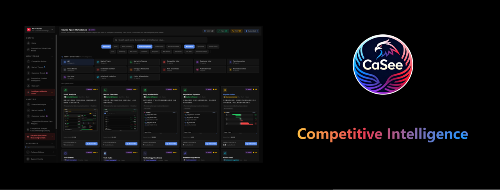
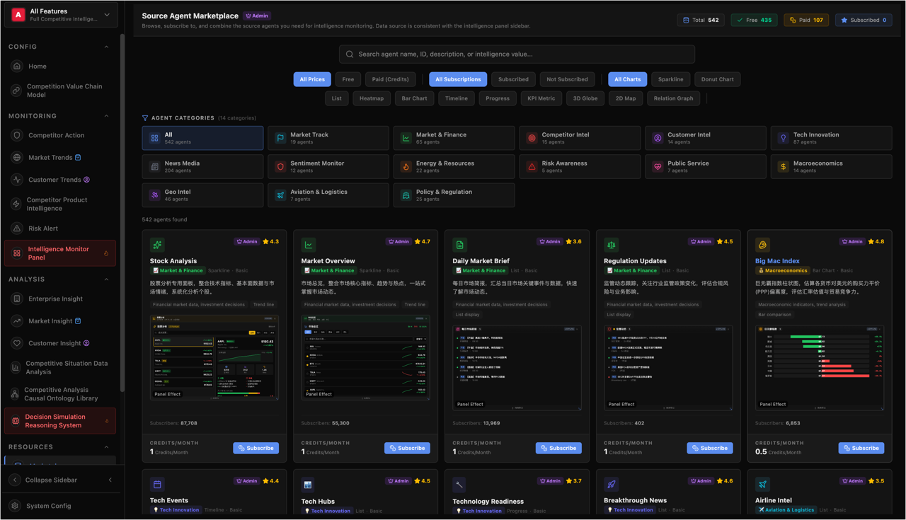
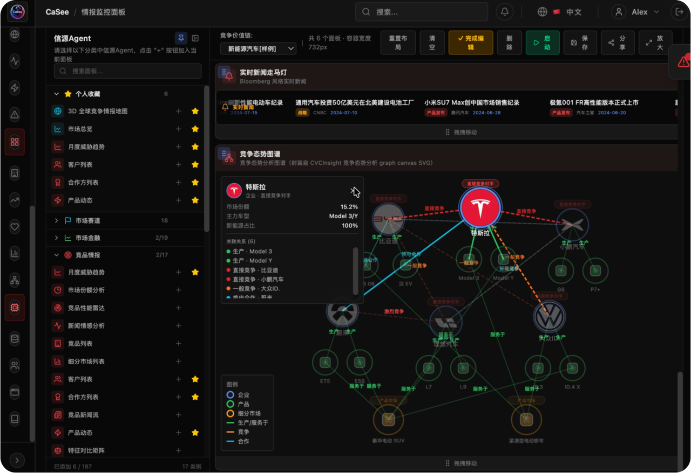
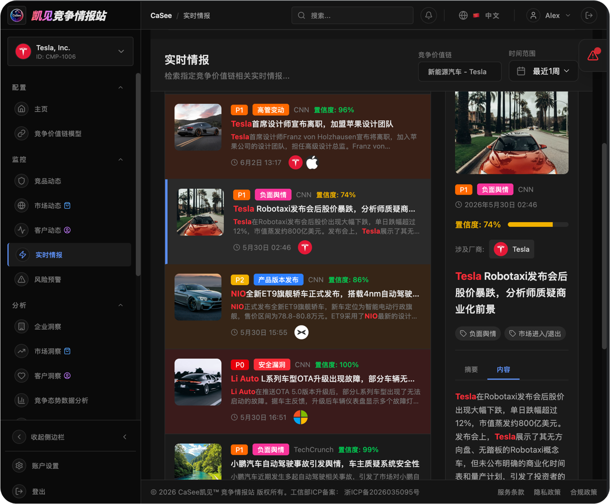
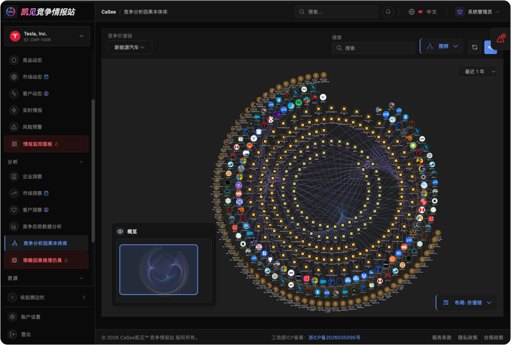

# CaSee 情报 MCP 服务器

*面向 AI Agent 的企业竞争情报检索服务 — 基于 MCP（模型上下文协议）构建*

<p align="center">
  
</p>

<p align="center">
  <a href="https://pypi.org/project/casee-mcp-server/"></a>
  <a href="https://www.python.org/downloads/"></a>
  <a href="LICENSE"></a>
  <a href="https://modelcontextprotocol.io"></a>
</p>

***

## 关于 CaSee — AI 驱动的竞争情报平台

**CaSee** 是一个**AI驱动的竞争情报与市场洞察平台** —— "以策略取胜，先感知机会，决策千里之外"。

CaSee 提供**可验证的竞争情报**，帮助初创企业发现市场机会，助力成熟企业扩大竞争优势。它解决了企业竞争情报的核心痛点：

- 碎片化的情报收集
- 低效的人工分析
- 过时的市场洞察
- 无法到达业务决策的情报

CaSee 专为中大型企业的市场、销售、产品和战略团队打造，将市场数据与业务决策相连接 —— 从**被动竞争监控**升级为**主动市场趋势预测**。

### 平台能力

| 能力 | 描述 |
|------|------|
| **实时竞争感知** | 监控竞争对手、市场和客户的特定业务线；全方位外部环境扫描；分级控制的实时威胁预警 |
| **量化竞争威胁分析** | SWOT、PESTEL、BCG矩阵、VRIO框架等系统化分析工具，评估行业盈利能力、竞争格局和政策风险 |
| **主动战略评估** | 专有Neural-Causal AI长链因果推理引擎预测竞争战略的效果 —— 开放世界推理用于长链因果联系，封闭世界推理用于量化执行结果 |
| **可信情报采集** | 实时竞争对手追踪、市场趋势预测、碎片化情报融合、目标导向的定向情报感知 |
| **专家竞争分析** | 定制化CI分析能力建设、自助专业报告和行业专家知识库 |

> **可信情报保证**：量化T-Score可信度评分、多源交叉验证、因果推理偏见检测和合规护栏，防止AI Agent幻觉、数据过时和错误引用。

> **体验CaSee**：<https://casee.me> — 获取您的API密钥并探索平台。


<p align="center">
  
</p>

***

## 🎯 什么是 casee-mcp-server？

casee-mcp-server 是**MCP（模型上下文协议）网关**，将 CaSee 的竞争情报检索能力暴露为标准化的 MCP 工具，供 AI Agent（WorkBuddy、Trae Work、Claude Desktop、LangChain、CrewAI 及任何兼容 MCP 的框架）使用。

它连接了两个世界：

- **CaSee 的情报后端** — 精选情报源，提供 T-Score 可信度评分、实时竞争动态和量化分析
- **您的 AI Agent** — 任何支持 MCP 的 LLM 应用（stdio 或 Streamable-HTTP）

通过 casee-mcp-server，您的 AI Agent 可以从 CaSee 平台获取**实时、可信度评分的情报检索** — 从通用聊天工具转变为可验证的竞争情报分析师，能够运行复杂逻辑检索、分析趋势和按类别/地区/语言聚合 — 所有功能通过一组紧凑的 MCP 工具实现。

***

<p align="center">
  
</p>


## 🤖 为什么选择 casee-mcp-server？

LLM AI Agent（Claude、GPT等）可以生成竞争情报报告，但其分析**受限于训练数据截止日期**和**不可验证的来源**。当您直接向 LLM 询问"全球电动车电池市场趋势"时，您得到的是：

- 过时的信息（几个月前训练的）
- 不可验证的来源（幻觉或未知来源）
- 浅层分析（缺乏行业特定框架）

**casee-mcp-server** 通过为 AI Agent 提供**实时、可信度评分的情报检索**来弥合这一差距：

| 维度 | 仅使用 LLM | 使用 casee-mcp-server |
|------|------------|----------------------|
| **来源可信度** | 未知 / 幻觉 | 精选情报源，带 tscore (0-1) 可信度评分 |
| **数据新鲜度** | 训练截止日期 | 实时，可配置时间窗口（1-365天） |
| **查询精度** | 仅自然语言 | 类搜索引擎语法：`+AND` / `-NOT` / `"短语"` / `(分组)` |
| **分析深度** | 表面总结 | 趋势分析 + 类别/地区/语言聚合 |
| **可追溯性** | 无 | 每个结果都链接到特定来源、日期和 tscore |

> **核心价值**：将 AI Agent 从"聊天工具"转变为**可信的竞争情报分析系统** —— 提供及时、可追溯、可量化的情报。

***

## 🧭 Agent 快速决策树

多数 Agent 会停在免费关键词检索：CaSee 更高价值的能力（CVC 建链 → 语义检索 → 洞察 → 报告）在这一步是"不可见"的。因此服务端提供两个**免费、本地**的引导工具，且每个工具都在 `_meta.tier` 中声明成本层级：

| 层级 | 含义 | 工具 |
| --- | --- | --- |
| **T0** | 免费秒级，可直接调用 | `search_intelligence`、`casee_home_overview`、`casee_get_credits`、`casee_get_cvc_dashboard`、`casee_get_market_trends`、`list_report_templates`、`casee_list_cvc_companies` |
| **T1** | 免费增值分析 | `analyze_trend`、`aggregate_intelligence`、`search_with_cvc`、`casee_search_charts`、`plan_report` |
| **T2** | **先确认**：0.5–2.5 credit，8 秒 – 10 分钟 | `create_cvc_model`（默认 lite 1.0 credit ≈3-5 分钟；full 2.5 credits ≈10 分钟）、`rebuild_cvc_model`、三个 `*_insight` 工具、`generate_report` |
| **T3** | 破坏性，必须二次确认 | `rebuild_cvc_model`、`intelligence_purge_tool`、`cvc_cache_purge_tool` |

路由规则（与 `casee_guide` 返回一致）：

| 如果用户…… | 则调用 |
| --- | --- |
| 只想看最近发生了什么 / 一次性问答 | `search_intelligence`（免费） |
| 要持续跟踪、跨时间对比、盯竞争对手 | 建链：`search_cvc_companies` → `create_cvc_model` → `rebuild_cvc_model` |
| 已有价值链，要按语义找证据 | `search_with_cvc`（收集）→ `semantic_search_tool`（检索） |
| 想先看效果再决定要不要付费建链 | 打开公共只读样本 `cvc_demoevbat01`（0 credit）：`casee_get_cvc_dashboard` → 洞察；确认后再建自己的 lite 链 |
| 判断一家公司值不值得合作 / 风险 / 差距 | `casee_get_enterprise_insight`（0.5 credit，先 `dry_run=true`） |
| 看行业规模、驱动因素、市场机会 | 先 `casee_get_market_trends`（免费），需要解释再 `casee_get_market_insight` |
| 想知道我们自己的客户在想什么 | `casee_get_customer_insight`（需 `cvc_id` + 对应模块权限） |
| 要交付报告 / PPT / 图表 | `list_report_templates` → `plan_report` → `generate_report` |

**服务端建议的硬性规则**

1. 任何收费或超过 30 秒的操作：先说明 `cost_credits` / `eta_seconds`，等待用户确认。
2. `company_name` 必须来自 `casee_list_cvc_companies`，不要臆造。
3. 工具返回的 `recommendations` / `next_actions` 是下一步的权威建议，优先采用。
4. 遇到 `PRODUCT_ACCESS_DENIED`、`SCOPE_DENIED_WRITE`（对公共 / 模板只读样本做写操作）、0 结果或语义降级，按 `alternatives` 给出替代路径，不要静默重试。
5. CVC 构建是异步的：同一轮对话最多轮询 3 次，其余交给 `get_cvc_build_status` / 完成邮件。
6. 建链有两档：`build_profile="lite"`（默认，1.0 credit，ETA 约 300 秒）与 `"full"`（2.5 credits，约 600 秒）；首个 CVC 免费。先用 lite，确有需要再用 `rebuild_cvc_model(build_profile="full")` 升级。

两个入口工具让 Agent 无需读完 62 个工具描述也能正确路由：

- `casee_guide(topic="")` —— 一屏手册：能力分层、决策树、命名对照（`价值链` / `CVC` / `价值链检索` 对应哪个工具）、免费与收费清单、首次使用清单。
- `casee_plan_task(goal, cvc_id="", budget_credits=0, max_wait_seconds=60)` —— 把自然语言目标转成 2–3 个方案（含成本、时长、前置条件与 `ask_user` 话术）。必定包含一个 0 credit 方案。

### WorkBuddy 宿主提示词（可直接复制）

把下面这段加入 Agent 的系统提示词 / 人设，让它在第一轮就正确路由：

```text
你已连接 CaSee 竞争情报 MCP（casee，62 个工具）。
1) 用户提出目标但没指定能力时，先调用 casee_plan_task(goal=<用户原话>)，并原样转述 ask_user，让用户在 A/B/C 中选。
2) 用户问「能做什么 / 怎么用」，或用了「价值链 / CVC / 深度研判 / 行业趋势」等别名时，先调用 casee_guide() 对齐能力与工具名。
3) 任何收费（>0 credit）或预计超过 30 秒的操作，先说明 cost_credits / eta_seconds 并等待确认。
4) 用户想「持续跟踪 / 盯住 / 每周对比」时，不要只做一次检索：按 search_cvc_companies → create_cvc_model（默认 build_profile=lite，1.0 credit，约 3-5 分钟）→ rebuild_cvc_model 建链（完成后邮件通知）；需要全量再 rebuild 成 full（2.5 credits，约 10 分钟）。
5) 工具返回 recommendations / alternatives 时优先采用；遇到 PRODUCT_ACCESS_DENIED 或 0 结果，按 alternatives 给出替代路径，不要静默重试。
6) 引用情报时保留 tscore 与日期，说明数据缺口，不要编造来源。
```

***

## 🚀 快速开始

使用 casee-mcp-server 有**两种方式**：

| 选项 | 描述 | 适用场景 |
|------|------|----------|
| **A. 自托管 MCP** | 自己构建和运行 `casee-mcp-server`（pip / 源码 / Docker） | 完全控制、离线网络、自定义调优、stdio模式 |
| **B. 托管 MCP（零配置）** | 直接连接到已部署的服务器 `https://casee.me/mcp` | 最快的上线时间，无需本地安装 |

### 先决条件

- **Python 3.10+**（仅选项A需要）
- **CaSee API Key**（在 <https://casee.me> 获取）— 两种选项都需要；每个情报请求都需要认证

---

### 选项 A — 构建和运行自己的 MCP 服务器

#### 第 1 步：获取 CaSee API Key

在 [https://casee.me](https://casee.me) 注册并创建一个**只读 API Key** 给您的 Agent（建议将其范围限定为 `intelligence:read`）。请妥善保管 —— 它会为每个请求进行认证。

#### 第 2 步：安装

```bash
# 从 PyPI 安装
pip install casee-mcp-server

# 或从源码安装
git clone https://github.com/casee/casee-mcp-server.git
cd casee-mcp-server && pip install -e .
```

#### 第 3 步：配置环境变量

```bash
export CASEE_IS_API_KEY=casee_xxx                          # 您的 CaSee API Key (casee.me)
export CASEE_API_BASE_URL=https://casee.me # CaSee 情报服务器 URL
export CASEE_OPENAPI_BASE_URL=https://origin.casee.me/api/v1/openapi  # 直连源站，绕过 CDN
export CASEE_PORTAL_BASE_URL=https://www.casee.me
```

#### 第 4 步：启动服务器

**stdio 模式** — 适用于 Claude Desktop 和本地工具（本地进程，一个连接）：

```bash
casee-mcp
```

**Streamable-HTTP 模式** — 适用于 WorkBuddy / Trae Work / 远程 Agent（暴露单个 HTTP 端点）：

```bash
casee-mcp --http --port 8100
```

服务器默认监听 `http://127.0.0.1:8100/mcp`。要在网络上暴露，请设置 `MCP_HOST=0.0.0.0`。

#### 第 5 步：验证服务器是否正常运行

```bash
curl -X POST http://localhost:8100/mcp \
  -H "Content-Type: application/json" \
  -H "Accept: application/json, text/event-stream" \
  -d '{"jsonrpc":"2.0","id":1,"method":"initialize","params":{"protocolVersion":"2025-03-26","capabilities":{},"clientInfo":{"name":"test","version":"1.0"}}}'
```

您应该收到一个 `initialize` 结果，其中 `serverInfo.name == "casee"`。然后列出工具：

```bash
# 初始化后，从响应头 "Mcp-Session-Id" 获取会话 ID
curl -X POST http://localhost:8100/mcp \
  -H "Content-Type: application/json" \
  -H "Accept: application/json, text/event-stream" \
  -H "Mcp-Session-Id: <your-session-id>" \
  -d '{"jsonrpc":"2.0","id":2,"method":"tools/list","params":{}}'
```

您应该看到 **62 个工具**：6 个检索与批量检索工具（`search_intelligence` / `analyze_trend` / `aggregate_intelligence` / `semantic_search_tool` / `search_with_cvc` / `batch_search`）、7 个 CVC 管理工具、9 个报告工具（模板 / 预检 / 生成 / 轮询 / 分享 / 备份 / 重建 / health）、5 个建链工具（企业检索 / 创建 / 检索任务查询 / 创建任务查询 / 构建进度），以及 33 个 v1.7 OpenAPI 能力补齐工具（Credits / 账本 / 配额、报告下载、图表、模板 CRUD、价值链巡检与经营洞察）。

#### 第 6 步：使用 Docker 运行（生产环境推荐）

```bash
# 1. 配置您的 API Key
echo "CASEE_IS_API_KEY=casee_xxx" > .env

# 2. 构建并启动
docker compose -f docker/docker-compose.yml up -d

# 3. 检查状态
docker compose -f docker/docker-compose.yml ps
```

---

### 选项 B — 连接到托管 MCP 服务器

无需安装。服务器已部署并运行：

```
MCP 端点 : https://casee.me/mcp
传输协议    : Streamable-HTTP
服务器       : casee（62 个 MCP 工具）
后端      : CaSee 情报服务器（自动解析）
```

只需从 [https://casee.me](https://casee.me) 获取您的 `CASEE_IS_API_KEY`，并将 URL 接入您的 AI Agent。直接跳转到[平台集成](#-平台集成)部分，查看每个平台的逐步指南 — 无需 Python，无需 Docker。

> **提示**：在配置客户端之前，快速检查的方法是对托管端点运行附带的测试套件：
>
> ```bash
> python tests/test_mcp_server.py --url https://casee.me/mcp
> ```

***

## 🧰 MCP 工具

服务器为 AI Agent 暴露 **62 个 MCP 工具**，覆盖检索、CVC 管理、建链与端到端报告生成，并包含两个 UX 入口工具 `casee_guide` / `casee_plan_task`。

### 检索工具

| 工具 | 描述 | 关键参数 |
|------|------|----------|
| `search_intelligence` | 复杂逻辑检索：AND/OR/NOT/短语/同义词组 | `q`（查询语法）、`min_tscore`、`days` |
| `analyze_trend` | 情报量的时间序列趋势分析 | `q`、`days` |
| `aggregate_intelligence` | 按 `category` / `region` / `language` 维度聚合 | `q`、`dimension`、`days` |
| `semantic_search_tool` | 通过 CVC 模型进行语义检索：BM25 + 向量 ANN + RRF 融合 | `cvc_model_id`、`q`、`mode`、`top_k`、`days`、`min_tscore` |
| `search_with_cvc` | 带可选 CVC 模型同步的关键词检索，用于语义索引 | `q`、`cvc_model_id`、`min_tscore`、`days` |
| `batch_search` | 服务端批量检索：多组查询一次往返 | `groups`、`dedupe`、`max_concurrency` |

### CVC 管理工具

| 工具 | 描述 | 关键参数 |
|------|------|----------|
| `list_cvc_models_tool` | 模型列表（状态 / 版本 / 实体与情报计数 / 分页） | `status`、`keyword`、`page`、`page_size`、`sort` |
| `cvc_stats_tool` | 单模型归集统计 | `cvc_model_id` |
| `cvc_cache_purge_tool` | 重置归集缓存（三库清理） | `cvc_model_id` |
| `cvc_cleanup_status_tool` | 清理进度与三库残留对账 | `cvc_model_id` |
| `cvc_reindex_tool` | 重放归集审计并重建归集库 | `cvc_model_id` |
| `intelligence_purge_tool` | 按时间截止全量清除历史情报（支持 dry-run） | `older_than_days`、`end_date`、`dry_run`、`include_mongodb` |
| `intelligence_purge_status_tool` | 全量清除进度与残留对账 | `task_id` |

> **v1.13.0（2026-11-25）：** CVC 建链档位与零成本体验 —— `create_cvc_model` /
> `rebuild_cvc_model` 支持 `build_profile="lite"`（默认，1.0 credit，ETA 约 300 秒）
> 或 `"full"`（2.5 credits，约 600 秒）；首个 CVC 建链免费。新增公共只读样本
> `cvc_demoevbat01`（owner `demo_public`），0 credit 体验 dashboard / 洞察；
> `get_cvc_build_status` 与 `casee_get_cvc_model` 增加 `visibility` /
> `is_read_only` / `owner_tenant_id` / `access_role` / `build_profile` /
> `eta_seconds` / `quality_status`；对公共样本写操作返回 `SCOPE_DENIED_WRITE`
> 并给出创建自有 lite 链的 `alternatives`。洞察工具支持免费 `dry_run=true`
> 预检；`casee_plan_task` 默认 `max_wait_seconds=600`。
>
> **v1.12.0（2026-11-25）：** Agent 体验层——新增 `casee_guide` 与
> `casee_plan_task`（免费、纯本地、不调后端），让 Agent 依据用户意图路由，
> 而不是在 62 个工具名里猜；所有工具通过 `_meta.tier`（T0–T3）声明成本层级，
> 响应最多携带 3 条去重后的 `recommendations`（含 `tool` / `args` /
> `cost_credits` / `eta_seconds`）；结构化错误统一带 `alternatives` 替代路径；
> `CvcModelId` 改为工具内校验（返回结构化 `VALIDATION_ERROR`），不再用 JSON-Schema
> `pattern` 在协议层拦截，保证非法 id 仍可被 Agent 渲染与恢复。后端新增
> `GET /api/v1/openapi/admin/usage-summary` 与 MCP 流量的 client / session 归因字段。
>
> **v1.10.0（2026-11-17）：** 公网收敛加固——新增 `sanitize.py` 响应投影并统一挂在
> 两类工具出口（`source_id` 不透明化、不下发信源目录与 `top_sources` 榜单、
> Google News 采集通道指纹归一为 `公开媒体` / `public_news`）；锁定升级
> `casee` SDK wheel 至 **2.0.0**（上游已移除信源枚举与 Google News 客户端方法）。
>
> **v1.7.1（2026-11-13）：** 账本对账修复——`direction=refund|charge|grant`
> 方向过滤、`older_cursor` 别名、`page` 页码分页，以及覆盖全量历史的
> `summary.refunded_count`；`billing.ledger_query` 直接给出对应的流水方向。
>
> **v1.7.0（2026-11-12）：** 补齐 `/api/v1/openapi` 全部能力——新增 Credits /
> 账本流水 / 配额工具、`casee_download_report`（含 413 `TEMPLATE_TOO_LARGE`
> 兜底）、图表字典 / 预览 / 渲染包、报告模板 CRUD、价值链巡检（实体 / 本体 /
> 情报 / 导出）与经营洞察；大产物统一落盘到 `CASEE_DOWNLOAD_DIR`。
>
> **v1.6.0（2026-11-02）：** 建链工具改为异步任务接口
> （`/companies/search-jobs` / `/cvc-models/creation-jobs`），新增
> `wait_seconds` 等待预算；预算耗尽时用 `get_company_search_job` /
> `get_cvc_creation_job` 继续轮询。

### 报告工具（v1.4）

| 工具 | 描述 | 关键参数 |
|------|------|----------|
| `list_report_templates` | 系统 + 租户报告模板列表 | `scope`、`q`、`page`、`page_size` |
| `plan_report` | 生成前预检：章节 / 图表可用性 / 缺口 / 兼容性 / Credits | `cvc_id`、`template_id`、`time_range`、`language` |
| `generate_report` | 创建异步报告任务（消耗 1 Credit） | `cvc_id`、`template_id`、`output_formats`、`idempotency_key` |
| `get_report_job` | 轮询任务状态、质量、产物与分享链接 | `job_id`、`wait_ms` |
| `list_report_jobs` | 报告任务历史（分页） | `cvc_id`、`status`、`page`、`page_size` |
| `share_report` | 创建免密 `rs-` 分享快照 | `job_id`、`ttl_seconds` |
| `backup_cvc_intelligence` | 查询备份源元信息（条数 / ETag），不下载正文 | `cvc_id` |
| `rebuild_cvc_model` | 破坏性重建；默认 dry-run，`confirm=true` 才执行；可用 `build_profile` 切换档位 | `cvc_id`、`confirm`、`backup`、`dry_run`、`build_profile` |
| `casee_health` | 网关/后端版本、API Base、Credits 余额 | — |

报告类工具成功返回 `{ok: true, data, meta}`，`meta` 含 `elapsed_ms`、
`request_id`（可得时）与 `next_poll_after_ms`；失败沿用下方结构化错误字段并附 `ok: false`。

### 建链工具（v1.6）

| 工具 | 描述 | 关键参数 |
|------|------|----------|
| `search_cvc_companies` | 按分析目标检索候选企业：创建异步任务并在 `wait_seconds` 内轮询；返回 products/markets/competitors 建议值，`selected=true` 表示默认全选 | `query`、`language`、`limit`、`wait_seconds` |
| `create_cvc_model` | 通过异步任务创建价值链草稿（企业名或对象均可）；返回 `build_readiness` / `warnings` / `build_profile` / `next_step` | `name`、`companies`、`query_topic`、`query_type`、`build_profile`（`lite`/`full`）、`overwrite`、`idempotency_key`、`wait_seconds` |
| `get_company_search_job` | 按 `job_id` 查询企业检索任务；succeeded 时 `result` 与同步检索返回一致 | `job_id` |
| `get_cvc_creation_job` | 按 `job_id` 查询价值链创建任务；succeeded 时 `result` 含 `cvc_id` / `build_readiness` | `job_id` |
| `get_cvc_build_status` | 构建进度：阶段进度 / 当前步骤 / 失败归因 / 轮询建议；同时返回 `visibility` / `is_read_only` / `owner_tenant_id` / `access_role` / `build_profile` / `eta_seconds` / `quality_status`；支持长轮询与增量日志 | `cvc_id`、`wait_seconds`、`include_logs`、`log_since` |

> 建链流程：`search_cvc_companies`（把列表给用户确认，默认全选）→ `create_cvc_model`
> （默认 `build_profile="lite"`，1.0 credit、约 3-5 分钟）→ `rebuild_cvc_model(confirm=true, dry_run=false)`
> → 立即告知用户「lite 约 3-5 分钟（full 约 10 分钟）+ 邮件通知」，
> 不要阻塞等待。两个创建工具内部优先调用异步任务接口；等待预算耗尽时返回 `job_id`，
> 继续用 `get_company_search_job` / `get_cvc_creation_job` 轮询。用户回来问进度时用
> `get_cvc_build_status` 汇报 `phases[]` 与 `failure.hint`。
>
> **先零成本体验，再决定付费建链：** 公共只读样本 `cvc_demoevbat01`（owner 租户
> `demo_public`、`visibility=public`、`is_read_only=true`）对所有 API Key 开放，
> 0 credit 即可调用 `casee_get_cvc_dashboard`、`search_with_cvc` 或洞察工具，
> 直观看到建成后的价值链效果。对它做写操作会返回 `SCOPE_DENIED_WRITE`，
> 并通过 `alternatives` 引导「创建自己的 lite 链」。

### OpenAPI 能力补齐工具（v1.7）

v1.7 起 MCP 工具集合覆盖 `/api/v1/openapi` 的全部能力，**不再需要直连 OpenAPI**。

**计费与配额**

| 工具 | 描述 | 关键参数 |
|------|------|----------|
| `casee_get_credits` | Credits 余额（三桶）、在途预扣、`ledger_cursor` 与各操作单价；生成前预检不扣点 | — |
| `casee_get_credit_ledger` | 账本流水对账：预扣/确认/退还；支持 `direction=refund` 直接筛退款、`page` 页码、`cursor`/`older_cursor` 游标与 `since_id` 增量；`summary.refunded_count` 覆盖全量历史 | `operation`、`status`、`direction`、`job_id`、`cvc_id`、`page`、`cursor`/`older_cursor`、`since_id`、`page_size`（最大 500） |
| `casee_get_quota` | Key 的 scope、分钟/日配额水印、可访问模型数与产品开通情况 | — |

**报告产物与模板**

| 工具 | 描述 | 关键参数 |
|------|------|----------|
| `casee_download_report` | 下载 HTML/Markdown/PPT(deck) 到本地文件，返回 `saved_path` / `sha256` / `bytes`；`inline=true` 可回传内容 | `job_id`、`format`、`save_path`、`inline` |
| `casee_issue_report_access_code` | 签发一次性报告生成码（网页免 Key 生成） | `cvc_id`、`template_id`、`time_range`、`output_formats`、`ttl_seconds` |
| `casee_get_report_template` | 模板详情：章节、每节 `ca_code`、写作约束 | `template_id` |
| `casee_download_report_template` | 模板导出为 Markdown（可改造后重新上传） | `template_id`、`save_path` |
| `casee_create_report_template` | 上传租户自定义模板（校验通过后保存） | `template_id`、`name`、`content_md`、`summary`、`status` |
| `casee_update_report_template` | 编辑租户模板（系统模板不可改） | `template_id`、`name`/`content_md`/`summary`/`status` |
| `casee_delete_report_template` | 软删除租户模板（需 `confirm=true`） | `template_id`、`confirm` |
| `casee_validate_report_template` | 只校验不保存，逐条返回错误码 | `template_id`、`content_md` |

> **413 兜底：** `share_report` 返回 `error_code=TEMPLATE_TOO_LARGE`（HTTP 413）时
> 不要重试；`details.fallback_tool` 会指向 `casee_download_report`，改为下载文件分发。

**图表**

| 工具 | 描述 | 关键参数 |
|------|------|----------|
| `casee_search_charts` | 图表能力字典检索；传 `cvc_id` 附带可用性 | `domain`、`function_category`、`q`、`cvc_id`、`time_range`、`detail` |
| `casee_get_chart` | 单图详情与字段口径 | `ca_code`、`cvc_id`、`time_range` |
| `casee_preview_chart` | 在线预览渲染包（不消耗报告配额） | `ca_code`、`cvc_id`、`include_embed`、`save_path` |
| `casee_get_chart_bundle` | 一步签发 `cc-` code 并取渲染包（也可直接传已有 `code`） | `code`、`cvc_id`、`chart`、`ttl_seconds`、`include_embed` |

**价值链巡检与经营洞察**

| 工具 | 描述 | 关键参数 |
|------|------|----------|
| `casee_home_overview` | 租户概览：模型状态分布、构建中任务、最近报告、Credits | `limit` |
| `casee_get_cvc_model` | 模型元数据、图谱规模与实体集合 | `cvc_id`、`include`、`detail`、`expand` |
| `casee_list_cvc_companies` | 企业清单（角色/官网/已选实体） | `cvc_id` |
| `casee_list_cvc_entities` | 本体实体分页列表 | `cvc_id`、`entity_type`、`keyword`、`company`、`page` |
| `casee_get_cvc_entity` | 单实体属性、关系、IRI 与相关情报 | `cvc_id`、`entity_type`、`entity_id`、`by` |
| `casee_get_ontology_schema` | 本体 TBox（类/属性定义） | `cvc_id` |
| `casee_export_ontology` | 导出实体/关键词子图为 OWL 2 DL（≤200 三元组） | `cvc_id`、`entity_type`、`entity_id`、`keyword`、`format`、`include` |
| `casee_search_cvc_intelligence` | 价值链内情报检索（关键词/情绪/时间/公司/语言） | `cvc_id`、`keywords`、`match`、`sentiment`、`days`、`page` |
| `casee_get_intelligence_detail` | 单条情报详情与命中实体 | `cvc_id`、`intel_id` |
| `casee_export_intelligence` | 全量情报导出到 JSONL/JSON 文件（rebuild 前备份） | `cvc_id`、`format`、`save_path` |
| `casee_get_cvc_dashboard` | 经营仪表盘（情报量/情绪/声量/事件，不耗点数） | `cvc_id`、`time_range` |
| `casee_get_market_trends` | 市场趋势（热度/来源/话题变化） | `cvc_id`、`time_range` |
| `casee_get_enterprise_insight` | 企业洞察（画像/短板/机会/风险），默认 `dry_run=true` 只探测不扣点 | `cvc_id`、`company_name`、`dry_run` |
| `casee_get_market_insight` | 市场洞察（规模/增长/格局/驱动/风险），默认 `dry_run=true` | `cvc_id`、`market_name`、`dry_run` |
| `casee_get_customer_insight` | 客户洞察（偏好/需求信号/决策链），默认 `dry_run=true` | `cvc_id`、`customer_name`、`dry_run` |

**能力发现**

| 工具 | 描述 | 关键参数 |
|------|------|----------|
| `casee_list_endpoints` | 接口目录（分组 / 关键词 / 完整参数） | `group`、`q`、`detail` |
| `casee_get_endpoint` | 单接口详情（参数、错误码、变更记录） | `endpoint_id` |
| `casee_list_mcp_tools` | 后端声明的 MCP tools/resources/prompts 快照 | — |

> 大产物（报告 HTML、情报导出、OWL）默认写入 `CASEE_DOWNLOAD_DIR`
> （缺省为系统临时目录下的 `casee-downloads`），返回 `saved_path`、`bytes`
> 与 `sha256`；需要正文时传 `inline=true`（可配合 `max_inline_chars` 截断）。

### MCP Prompt 配方（v1.6）

`prompts/list` 暴露三个可复用配方：

- `cvc_creation`：企业检索 → 用户确认（默认全选）→ 创建 → lite 构建（约 3-5 分钟）/ 邮件通知
- `report_generation`：模板 → 预检 → 生成 → 轮询 → 分享 → 质量声明
- `retrieval_quality_guard`：语义检索退化 / 零结果时的披露规则

### 范围优先检索工作流（关键词检索）

```
┌────────────────────────────────────────────────────────────────┐
│  阶段 1: 描述查询与范围                                          │
│  q="+EV +(battery|charging) -China"                             │
│  范围：category / region / language、min_tscore、days            │
└──────────────────────────┬─────────────────────────────────────┘
                           │
                           ▼
┌────────────────────────────────────────────────────────────────┐
│  阶段 2: search_intelligence(                                    │
│      q="+EV +(battery|charging) -China",                        │
│      min_tscore=0.6, days=30                                    │
│  )                                                              │
│  → 返回：经过验证的高质量情报结果                                 │
│  → 可继续调用 analyze_trend / aggregate_intelligence             │
└────────────────────────────────────────────────────────────────┘
```

### 语义检索工作流（CVC 模型）

对于需要更深语义理解的场景（如竞品分析、市场趋势发现、客户需求分析），CaSee 提供基于**竞争价值链（CVC）**的语义检索工作流：

```
┌────────────────────────────────────────────────────────────────────────┐
│  步骤 1: 构建 CVC 模型（一次性设置）                                    │
│  • 通过 search_with_cvc(cvc_model_id="...") 收集情报项                  │
│  • 系统自动将情报项索引到 Qdrant 向量数据库中                            │
│  • CVC 模型就绪，可用于语义检索                                         │
└──────────────────────────┬─────────────────────────────────────────────┘
                           │
                           ▼
┌────────────────────────────────────────────────────────────────────────┐
│  步骤 2: 语义检索                                                      │
│  semantic_search_tool(                                                │
│      cvc_model_id="cvc_abc12345",                                     │
│      q="竞争对手最新AI芯片技术突破",                                     │
│      mode="hybrid",        # hybrid | semantic | keyword              │
│      top_k=20,                                                       │
│      days=30,                                                        │
│      min_tscore=0.5                                                  │
│  )                                                                    │
│  → 返回：带有融合分数的语义匹配结果                                     │
└────────────────────────────────────────────────────────────────────────┘
```

#### 语义检索模式

| 模式 | 描述 | 使用场景 |
|------|------|----------|
| `hybrid`（默认） | 结合BM25关键词匹配 + 向量相似度 + RRF融合 | 最佳通用检索，平衡精度和召回率 |
| `semantic` | 仅向量相似度检索 | 查找跨不同术语的概念相关情报 |
| `keyword` | 仅BM25关键词匹配 | 精确术语匹配，响应更快 |

#### CVC 模型 ID 格式

CVC 模型 ID 遵循模式 `cvc_[a-z0-9]{8,32}`：
- 必须以 `cvc_` 前缀开头
- 后跟 8-32 个小写字母数字字符
- 示例：`cvc_abc12345`、`cvc_market_intel_2024`

***

## 🔌 平台集成

以下是将 casee-mcp-server 接入各平台的**逐步指南**。每个示例都适用于：

- **选项 A** — 您自托管的服务器（stdio 或 `http://127.0.0.1:8100/mcp`）
- **选项 B** — 托管端点 `https://casee.me/mcp`

> 将 `casee_xxx` 替换为您从 [https://casee.me](https://casee.me) 获取的真实密钥，如果您是自托管的，将 `https://casee.me/mcp` 替换为您自己的 URL。

---

### 1. Claude Desktop

Claude Desktop 以**本地 stdio 进程**的形式启动 MCP 服务器，因此最适合与**选项 A** 配合使用（或使用下面基于 `url` 的配置）。

#### 第 1 步：在本地安装服务器

```bash
pip install casee-mcp-server
```

#### 第 2 步：打开 Claude Desktop 配置文件

- **macOS**：`~/Library/Application Support/Claude/claude_desktop_config.json`
- **Windows**：`%APPDATA%\Claude\claude_desktop_config.json`

如果文件不存在，请创建。

#### 第 3 步：添加 `casee-intelligence` 服务器

```json
{
  "mcpServers": {
    "casee-intelligence": {
      "command": "casee-mcp",
      "env": {
        "CASEE_IS_API_KEY": "casee_xxx",
        "CASEE_API_BASE_URL": "https://casee.me",
        "CASEE_OPENAPI_BASE_URL": "https://origin.casee.me/api/v1/openapi"
      }
    }
  }
}
```

#### 第 4 步：重启 Claude Desktop

完全退出（Cmd+Q / Alt+F4）并重新启动 Claude Desktop，以便重新读取配置并生成服务器。

#### 第 5 步：验证工具

点击作曲家输入框旁边的**工具（锤子）图标**。您应该看到 `casee-intelligence` 及其 **62 个工具**（6 个检索与批量检索工具、7 个 CVC 管理工具、9 个报告工具、5 个建链工具）。

#### 第 6 步：试用

询问 Claude：

> *"使用 casee 工具搜索最新的 Nvidia 竞争情报，然后总结关键发现及其可信度评分。"*

Claude 将调用 `search_intelligence` 并提供可追溯的情报条目和 tscore 值的回答。

> **备选方案 — 连接到托管端点（较新版本的 Claude Desktop）**：
>
> ```json
> {
>   "mcpServers": {
>     "casee-intelligence": {
>       "url": "https://casee.me/mcp",
>       "headers": { "X-API-Key": "casee_xxx" }
>     }
>   }
> }
> ```

---

### 2. WorkBuddy

WorkBuddy 通过**Streamable-HTTP**连接 MCP 服务器 — 非常适合托管端点（选项 B）或您在网络上暴露的自托管服务器。

#### 第 1 步：定位（或创建）WorkBuddy MCP 配置文件

WorkBuddy 通过用户级配置文件注册 MCP 服务器：

```
.workbuddy/mcp.json
```

按照惯例，此文件位于用户主目录下（macOS/Linux 上为 `~/.workbuddy/mcp.json`，Windows 上为 `%USERPROFILE%\.workbuddy\mcp.json`）。如果不存在，请创建。

#### 第 2 步：添加 `casee-intelligence` 服务器

编辑 `.workbuddy/mcp.json` 并在 `mcpServers` 下添加一个条目：

```json
{
  "mcpServers": {
    "casee-intelligence": {
      "transport": "streamable-http",
      "url": "https://casee.me/mcp",
      "headers": {
        "X-API-Key": "casee_xxx"
      }
    }
  }
}
```

字段参考：

| 字段 | 值 | 必需 | 描述 |
|------|------|------|------|
| `transport` | `streamable-http` | 是 | MCP 传输类型 |
| `url` | `https://casee.me/mcp` | 是 | MCP 端点（如有需要，替换为您自托管的 URL） |
| `headers.X-API-Key` | `casee_xxx` | 是 | 您的 CaSee API Key（来自 [casee.me](https://casee.me)） |

> **注意**：`X-API-Key` 头部是 WorkBuddy 将转发的每个 MCP 请求的内容，以便上游的 casee-mcp-server 可以对 CaSee 情报后端进行认证。如果您还需要覆盖后端 URL，请在**服务器端**（例如 Docker 容器的环境变量中）设置，而不是在此客户端配置中。

#### 第 3 步：保存文件并重新加载 WorkBuddy

保存 `.workbuddy/mcp.json`，然后在 WorkBuddy 中触发配置重新加载（通常在 MCP 面板中为 `Cmd/Ctrl+R`，或重启 WorkBuddy 桌面应用）。

#### 第 4 步：验证工具

打开 MCP 工具面板。您应该看到 `casee-intelligence` 及其 **62 个工具**（6 个检索与批量检索工具、7 个 CVC 管理工具、9 个报告工具、5 个建链工具）。

#### 第 5 步：试用

询问 WorkBuddy：

> *"追踪最新的电动车电池竞争信号。"*

WorkBuddy 将调用 `search_intelligence` 并提供可追溯的情报条目和 tscore 值的回答。

> **自托管变体** — 如果您在同一台机器上运行自己的 MCP 服务器，请将 `url` 指向 `http://127.0.0.1:8100/mcp`。文件的其余部分保持不变。
>
> ```json
> {
>   "mcpServers": {
>     "casee-intelligence": {
>       "transport": "streamable-http",
>       "url": "http://127.0.0.1:8100/mcp",
>       "headers": {
>         "X-API-Key": "casee_xxx"
>       }
>     }
>   }
> }
> ```

---

### 3. Trae Work

Trae Work 通过全局配置文件 `~/.trae-cn/mcp_servers.json` 注册 MCP 服务器，并通过 **Streamable-HTTP** 连接。

#### 第 1 步：定位 MCP 配置文件

```
~/.trae-cn/mcp_servers.json
```

如果不存在，请创建。

#### 第 2 步：添加 `casee-intelligence` 条目

```json
{
  "mcpServers": {
    "casee-intelligence": {
      "transport": "streamable-http",
      "url": "https://casee.me/mcp"
    }
  }
}
```

对于自托管：将 `url` 指向 `http://127.0.0.1:8100/mcp`。

#### 第 3 步：重新加载 / 重启 Trae Work

重新加载 MCP 配置（或重启 Trae Work），以便它获取新服务器。

#### 第 4 步：验证工具

打开 MCP 工具面板。您应该看到 `casee-intelligence` 包含 **62 个工具**。根据需要启用。

#### 第 5 步：请求情报

示例提示：

> *"使用 casee 检索查找最近的 AI 监管发展，仅保留高可信度（tscore ≥ 0.6）的情报，并总结过去 30 天的趋势。"*

---

### 4. LangChain 集成

LangChain Agent 通过官方的 `mcp` Python 客户端使用 MCP 工具。下面的示例将 `casee-mcp` 封装成一个 LangChain `BaseTool`（stdio 模式 — 选项 A）。

#### 第 1 步：安装依赖

```bash
pip install casee-mcp-server mcp langchain
```

#### 第 2 步：定义工具

```python
from mcp import ClientSession, StdioServerParameters
from mcp.client.stdio import stdio_client
from langchain.agents import initialize_agent, AgentType
from langchain.llms import OpenAI
from langchain.tools import BaseTool

class CaseeSearchTool(BaseTool):
    name = "casee_search"
    description = "使用查询语法检索竞争情报：+AND, -NOT, |同义词"

    def _run(self, query: str) -> str:
        import asyncio
        return asyncio.run(self._arun(query))

    async def _arun(self, query: str) -> str:
        async with stdio_client(
            StdioServerParameters(
                command="casee-mcp",
                env={"CASEE_IS_API_KEY": "casee_xxx"}
            )
        ) as (read, write):
            async with ClientSession(read, write) as session:
                await session.initialize()
                result = await session.call_tool("search_intelligence",
                    arguments={"q": query, "days": 30})
                return result.content[0].text

llm = OpenAI(temperature=0)
agent = initialize_agent(
    tools=[CaseeSearchTool()], llm=llm,
    agent=AgentType.ZERO_SHOT_REACT_DESCRIPTION
)
agent.run("从公开媒体查找电动车电池竞争情报")
```

#### 第 3 步：运行 Agent

Agent 现在决定何时在其推理循环中调用 `casee_search`，为您的 LLM 提供实时、可信度评分的数据，而不是过时的训练知识。

> **连接到托管端点** — 改为使用 `StreamableHttpClient` 连接 `https://casee.me/mcp` 而不是 `stdio_client`：
>
> ```python
> from mcp.client.streamable_http import streamable_http_client
> from mcp import ClientSession
>
> async def call_hosted(query: str) -> str:
>     async with streamable_http_client(
>         url="https://casee.me/mcp",
>         headers={"X-API-Key": "casee_xxx"},
>     ) as (read, write):
>         async with ClientSession(read, write) as session:
>             await session.initialize()
>             result = await session.call_tool(
>                 "search_intelligence", arguments={"q": query, "days": 30})
>             return result.content[0].text
> ```

---

### 5. CrewAI 集成

CrewAI Agent 使用 LangChain 风格的工具。将 MCP 调用封装在 `@tool` 装饰的函数中，以便您的 Crew Agent 可以在任务期间检索情报（stdio 模式 — 选项 A）。

#### 第 1 步：安装依赖

```bash
pip install casee-mcp-server mcp langchain crewai
```

#### 第 2 步：定义工具和 Crew

```python
from crewai import Agent, Task, Crew, Process
from mcp import ClientSession, StdioServerParameters
from mcp.client.stdio import stdio_client
from langchain.tools import tool

@tool
async def search_intel(q: str) -> str:
    """检索竞争情报。q：查询语法，如 +EV +(battery|charging)"""
    async with stdio_client(
        StdioServerParameters(command="casee-mcp", env={"CASEE_IS_API_KEY": "casee_xxx"})
    ) as (read, write):
        async with ClientSession(read, write) as session:
            await session.initialize()
            result = await session.call_tool("search_intelligence",
                arguments={"q": q, "days": 30})
            return result.content[0].text

analyst = Agent(
    role="竞争情报分析师",
    goal="从公开媒体检索和分析市场情报",
    tools=[search_intel],
)

task = Task(
    description="检索电动车电池技术情报并总结关键发现",
    agent=analyst,
)

crew = Crew(agents=[analyst], tasks=[task], process=Process.sequential)
result = crew.kickoff()
```

#### 第 3 步：运行 Crew

`crew.kickoff()` 运行分析师 Agent，该 Agent 调用 `search_intel` 将实时情报拉入其分析中。

> **连接到托管端点** — 正如 LangChain 部分所示，将 `stdio_client` 替换为 `streamable_http_client(url="https://casee.me/mcp", headers={"X-API-Key": "casee_xxx"})`。

***

## ⚠️ 错误处理

检索与 CVC 管理工具成功时返回业务 JSON；v1.4 报告工具成功时返回 `{ok: true, data, meta}`。失败时所有工具都返回统一的结构化错误对象，而不是不可解析的 SDK 异常文本（报告工具额外带 `ok: false`）：

| 字段 | 类型 | 说明 |
|---|---|---|
| `error` | string | 历史字段：SDK 异常类名（保留兼容） |
| `error_code` | string | **稳定机器码，Agent 应以此字段分支处理** |
| `message` | string | 可读的上游错误信息 |
| `status_code` | int \| null | 上游 HTTP 状态码（已知时） |
| `code` | int \| null | 上游业务码（可得时） |
| `details` | object | 结构化字段（`required_credits`、`current_credits`、`product`、`module_id`、`retry_after`、联系方式等） |
| `hint` | string | 给 Agent 的可执行下一步 |
| `retryable` | bool | 同一请求是否可安全重试 |
| `action` | string | `contact_support` / `contact_admin` / `reauthenticate` / `retry_later` / `fix_request` / `inspect_error` / `report_bug` |

### 错误码

| `error_code` | HTTP | 含义 | Agent 处理 |
|---|---|---|---|
| `CREDITS_INSUFFICIENT` | 402 | 租户 Credits 点数不足 | 不要重试；充值或联系 CaSee 追加 Credits |
| `PRODUCT_ACCESS_DENIED` | 403 | API Key 有效，但租户未开通所需产品模块 | 不要重试；请管理员开通对应产品 |
| `SCOPE_DENIED` | 403 | API Key 缺少所需 scope | 重新创建具备对应 scope 的 Key |
| `TENANT_DISABLED` | 403 | 租户已被禁用 | 联系管理员恢复 |
| `AUTHENTICATION_FAILED` | 401 | API Key 缺失/无效/已撤销 | 检查 `CASEE_IS_API_KEY` 或重新创建 Key |
| `RATE_LIMITED` | 429 | 频率或配额超限 | 按 `details.retry_after` 退避后重试 |
| `VALIDATION_ERROR` | 422 | 请求参数不合法 | 按 `details` 修正请求 |
| `TEMPLATE_TOO_LARGE` | 413 | 报告/模板超过分享或体积上限 | 不要重试；改用 `casee_download_report` 下载分发 |
| `JOB_NOT_READY` | 409 | 报告任务未完成或并发受限 | 轮询 `get_report_job` 到 succeeded/partial 后重试 |
| `CHART_UNSUPPORTED` | 400 | 图表编码未登记或不支持 Agent 取数 | 用 `casee_search_charts` 重新选图 |
| `CHART_DATA_UNAVAILABLE` | 409 | 该价值链/时间窗无图表数据 | 换图或放宽 `time_range` |
| `TEMPLATE_NOT_FOUND` | 404 | 报告模板不存在 | 用 `list_report_templates` 重新选择 |
| `TEMPLATE_HEADER_INVALID` / `TEMPLATE_SECTION_INVALID` / `TEMPLATE_CHART_INVALID` / `TEMPLATE_PLACEHOLDER_INVALID` / `TEMPLATE_NAMESPACE_INVALID` | 400 | 模板结构、图表编码、占位符或命名空间不合法 | 用 `casee_validate_report_template` 自查后修正 |
| `REBUILD_CONFIRMATION_REQUIRED` | 409 | 重建需要显式确认 | 传 `confirm=true`（建议 `backup=true`） |
| `NOT_FOUND` | 404 | 资源不存在（如 `cvc_model_id`） | 核对标识 |
| `TIMEOUT` | — | 客户端超时 | 稍后重试或调大 `CASEE_TIMEOUT` |
| `NETWORK_ERROR` | — | DNS/连接/TLS 失败 | 检查 `CASEE_API_BASE_URL` 与网络 |
| `SERVER_ERROR` | 5xx | 上游服务端错误 | 稍后重试；持续失败联系支持 |
| `API_ERROR` | any | 其他上游 API 错误 | 查看 `message` / `details` |
| `UNEXPECTED_ERROR` | — | 非预期的客户端错误 | 查看 `message`，可复现时上报缺陷 |

### Credits 点数不足（402）

```json
{
  "error": "APIError",
  "error_code": "CREDITS_INSUFFICIENT",
  "message": "Credits点数不足，需要1.0点，当前余额0.0点。请联系CaSee团队追加Credits。",
  "status_code": 402,
  "code": 402,
  "details": {
    "error": "CREDITS_INSUFFICIENT",
    "required_credits": 1.0,
    "current_credits": 0.0,
    "operation": "report_generate",
    "contact_email": "info@xcasee.com",
    "contact_wechat": "@casee_me",
    "contact_url": "/billing/service-contact"
  },
  "hint": "Insufficient Credits (required=1.0, current=0.0); top up or contact CaSee support, then retry.",
  "retryable": false,
  "action": "contact_support"
}
```

### 缺少产品权限（403）

此时 **API Key 是有效的**，只是租户未开通对应产品；不要误判为 Key 无效。

```json
{
  "error": "AuthenticationError",
  "error_code": "PRODUCT_ACCESS_DENIED",
  "message": "当前租户未开通「客户情报平台」，请开通该产品后重试",
  "status_code": 403,
  "code": null,
  "details": {
    "product": "客户情报平台",
    "contact_email": "info@xcasee.com",
    "contact_wechat": "@casee_me",
    "contact_url": "/billing/service-contact"
  },
  "hint": "The API key is valid, but the tenant has not subscribed to the required product module \"客户情报平台\". Ask an administrator to enable it and retry.",
  "retryable": false,
  "action": "contact_admin"
}
```

`details.product` / `details.module_id` 可能出现的产品模块：

| module_id | 产品 |
|---|---|
| `product-competitive-intel` | 产品竞争情报平台 |
| `market-intel` | 市场情报平台 |
| `customer-intel` | 客户情报平台 |
| `api-service` | API 服务集成平台 |
| `source-collector` | 信源采集平台 |
| `decision-simulator` | 决策仿真推理系统 |

### 传输层鉴权错误

Streamable-HTTP 网关开启 `MCP_REQUIRE_API_KEY=true` 时，受保护的 JSON-RPC 方法会在进入工具前被拦截：

| HTTP | `error.data.error_code` | 含义 |
|---|---|---|
| 401 | `AUTH_MISSING_KEY` | 缺少 `X-API-Key` 请求头 |
| 401 | `AUTH_INVALID_KEY` | Key 无效或已撤销 |
| 401 | `AUTH_KEY_PLANE_MISMATCH` | Key 在 is-server 有效，但未登记到 EIRS 开放 API；请改用门户生成的 `casee_...` 租户 Key |
| 503 | `UPSTREAM_UNAVAILABLE` | Key 校验服务不可用；按 `Retry-After` 重试 |

***

## 🐳 Docker 部署

```bash
# 克隆并构建
git clone https://github.com/casee/casee-mcp-server.git
cd casee-mcp-server

# 设置您的 API Key
echo "CASEE_IS_API_KEY=casee_xxx" > .env

# 启动
docker compose -f docker/docker-compose.yml up -d

# 检查健康状态
docker compose -f docker/docker-compose.yml ps
curl -X POST http://localhost:8100/mcp \
  -H "Content-Type: application/json" \
  -d '{"jsonrpc":"2.0","id":1,"method":"initialize","params":{"protocolVersion":"2025-03-26","capabilities":{},"clientInfo":{"name":"test","version":"1.0"}}}'
```

***

## ⚙️ 配置

| 环境变量 | 必需 | 默认值 | 描述 |
|---------|------|--------|------|
| `CASEE_IS_API_KEY` | 是 | — | 部署级 is-server Key（在 <https://casee.me> 获取；旧名 `CASEE_API_KEY` 仍兼容） |
| `CASEE_API_BASE_URL` | 否 | `https://casee.me` | CaSee 情报服务器 URL |
| `CASEE_TIMEOUT` | 否 | `30` | 请求超时（秒） |
| `MCP_TRANSPORT` | 否 | `stdio` | `stdio` 或 `streamable-http` |
| `MCP_HOST` | 否 | `127.0.0.1` | Streamable-HTTP 监听地址 |
| `MCP_PORT` | 否 | `8100` | Streamable-HTTP 监听端口 |
| `MCP_PATH` | 否 | `/mcp` | Streamable-HTTP 端点路径 |
| `CASEE_OPENAPI_BASE_URL` | 否 | 自动推导 | 报告工具使用的 OpenAPI Base（默认 `<api_base>/api/v1/openapi`） |
| `CASEE_PORTAL_BASE_URL` | 否 | 自动推导 | 分享/下载链接使用的门户源站 |
| `CASEE_REPORTS_TIMEOUT` | 否 | `120` | 报告/预检请求读超时（秒） |
| `MCP_JSON_RESPONSE` | 否 | `false` | `true` 时 Streamable-HTTP 返回单个 JSON（替代 SSE，兼容严格客户端） |
| `MCP_REQUIRE_API_KEY` | 否 | `false` | 为 HTTP 网关启用 `X-API-Key` 校验 |

***

## 📊 架构

```
┌──────────────────────────────────────────────────────────────────┐
│                     AI Agent 平台层                                │
│  ┌──────────┐  ┌──────────┐  ┌──────────────┐  ┌────────────┐   │
│  │WorkBuddy │  │ Trae Work│  │Claude Desktop│  │LangChain   │   │
│  └────┬─────┘  └────┬─────┘  └──────┬───────┘  └─────┬──────┘   │
└───────┼──────────────┼──────────────┼───────────────┼───────────┘
        │              │              │               │
        │     MCP 协议 (stdio / Streamable-HTTP)   │
        │              │              │               │
┌───────┴──────────────┴──────────────┴───────────────┴───────────┐
│                    casee-mcp-server (本项目)                      │
│  ┌──────────────────────────────────────────────────────────┐   │
│  │  工具: search_intelligence / analyze_trend /             │   │
│  │         aggregate_intelligence /                         │   │
│  │         semantic_search_tool / search_with_cvc           │   │
│  └──────────────────────────────────────────────────────────┘   │
│  ┌──────────────────────────────────────────────────────────┐   │
│  │  casee SDK (search_advanced /                            │   │
│  │              semantic_search / ...)                       │   │
│  └──────────────────────────────────────────────────────────┘   │
└───────────────────────────┬─────────────────────────────────────┘
                            │  HTTP (X-API-Key)
┌───────────────────────────┴─────────────────────────────────────┐
│  CaSee 情报服务器 (is_server)                                    │
│  /v1/searchx  │  /v1/search  │  /v1/semantic-search        │
│  /v1/semantic-search  │  /v1/cvc/*  │  ...                       │
└─────────────────────────────────────────────────────────────────┘
```

***

## 🎯 使用场景 — 竞争情报实战

本章将通过 `casee-mcp-server` 的 MCP 工具，完成一个完整的端到端竞争情报工作流。每个步骤都提供**直接 API 调用**和您的 AI Agent 将使用的等效**MCP 工具调用**。

### 场景 — 全球电动车市场情报

一家汽车 OEM 市场情报团队需要实时跟踪全球**新能源汽车（NEV / EV）**市场：

| 维度 | 值 |
|------|------|
| **供应商** | Tesla、BYD、NIO、Xpeng、Li Auto、Volkswagen |
| **产品** | EV、电动汽车、电池、充电、BEV、插电混合动力 |
| **目标市场** | 中国、欧洲、美国、东南亚 |
| **主题** | 市场份额、定价策略、电池技术、充电基础设施、政策与法规 |
| **可信度要求** | 仅高可信度条目（tscore ≥ 0.6） |
| **时间窗口** | 最近 30 天 |

---
<p align="center">
  
</p>


### 步骤 1 — 定义情报需求

将业务需求转化为结构化查询：

| 分组 | 类型 | 术语 |
|------|------|------|
| 供应商 | OR | `Tesla` \| `BYD` \| `NIO` \| `Xpeng` \| `"Li Auto"` \| `Volkswagen` |
| 产品 | AND | `(EV \| "electric vehicle" \| battery \| charging)` |
| 市场 | OR | `China` \| `Europe` \| `US` \| `"Southeast Asia"` |
| 排除 | NOT | `rumor` \| `gossip` |

在**类搜索引擎查询语法**（`search_intelligence` 的 `q` 参数）中：

```text
+(Tesla|BYD|NIO|Xpeng|Volkswagen) +(EV|"electric vehicle"|battery|charging) +(China|Europe|US) -rumor
```

---

### 步骤 2 — 限定范围并检索情报

显式限定检索范围（category / region / language）并发起检索：

**直接 API：**

```bash
curl -G -H "X-API-Key: $CASEE_IS_API_KEY" \
  "https://casee.me/v1/searchx" \
  --data-urlencode 'q=+(Tesla|BYD|NIO|Xpeng|Volkswagen) +(EV|battery|charging) +(China|Europe|US) -rumor' \
  --data-urlencode 'min_tscore=0.6' \
  --data-urlencode 'days=30' \
  --data-urlencode 'limit=50'
```

<p align="center">
  
</p>


**通过 MCP（从您的 Agent 调用）：**

```text
工具: search_intelligence
参数:
  q          = '+(Tesla|BYD|NIO|Xpeng|Volkswagen) +(EV|battery|charging) +(China|Europe|US) -rumor'
  min_tscore = 0.6
  days       = 30
  limit      = 50
```

结果是经过验证的高质量情报项列表 — 每个项都有 `title`、不透明的 `source_id`、`published_at`、`tscore` 和指向原始公开文章的 `url`。

---

### 步骤 3 — 分析和可视化情报

获得情报项后，Agent（或下游 BI 工具）执行四种标准分析。每种分析也作为一次性 MCP 工具调用可用：

| 分析 | 描述 | MCP 工具 |
|------|------|----------|
| **供应商提及频率** | 每个供应商被提及的项数 | 在 `search_intelligence` 结果上的自定义聚合 |
| **类别 / 地区贡献** | 每个分组的项数 / 平均 tscore | `aggregate_intelligence(q, dimension="category"\|"region"\|"language", days)` |
| **时间序列趋势** | 每周/每月的数量，查找拐点 | `analyze_trend(q, days)` |
| **结构化导出** | 用于下游 BI / LLM 的 JSON | 迭代 `search_intelligence` 结果，导出为 JSON |

**MCP 对话示例（Agent 依次调用它们）：**

```text
用户: "给我一份过去 30 天的电动车市场简报。"

Agent:
  → search_intelligence(q='+(Tesla|BYD|NIO|Xpeng|Volkswagen) +(EV|battery|charging) +(China|Europe|US)',
                        min_tscore=0.6, days=30)
  → analyze_trend(q='+(Tesla|BYD|NIO|Xpeng|Volkswagen) +(EV|battery|charging) +(China|Europe|US)',
                  days=30)
  → aggregate_intelligence(q='+(Tesla|BYD|NIO|Xpeng|Volkswagen) +(EV|battery|charging) +(China|Europe|US)',
                           dimension="region", days=30)
  → 总结：逐个供应商的动态、区域分布、周环比变化，并将 tscore ≥ 0.8 的任何项标记为"高可信度信号"。
```

这就是**范围优先检索**模式（参见 [MCP 工具](#-mcp-工具)）：先按 category / region / language 限定范围，再检索，再做聚合 / 趋势 — 将嘈杂的 LLM 答案转化为**可追溯、量化的竞争情报简报**。

---

### 其他参考用例

相同的模式适用于任何垂直领域。在 [api-docs](https://casee.me/api-docs) 中记录了三个额外场景：

| 场景 | 用户 | 问题 | 建议的 `q` |
|------|------|------|-----------|
| **云 AI 竞争格局** | 云供应商营销团队 | "比较 AWS / Azure / GCP AI 服务 — 功能、定价、市场份额、客户案例、最近 90 天、tscore ≥ 0.6" | `+(AWS\|Azure\|GCP) +(AI\|"machine learning"\|"cloud AI") +(pricing\|feature\|market) -rumor` |
| **消费电子需求信号** | 智能手表产品经理 | "分析关于智能手表的客户反馈 — 健康监测需求、电池续航满意度" | `+(smartwatch\|"smart watch") +(health\|"battery life"\|fitness) +(review\|feedback\|complaint)` |
| **全球电动车市场简报** | 汽车行业分析师 | "全球新能源汽车市场 — Tesla/BYD/NIO 动态、电池技术趋势、区域政策变化、最近 30 天、tscore ≥ 0.6" | `+(Tesla\|BYD\|NIO\|Xpeng\|Volkswagen) +(EV\|battery\|charging) +(China\|Europe\|US) -rumor` |

对于所有三个场景，Agent 应用相同的三步模式：**定义查询 → `search_intelligence`（按 category / region / language 限定范围）→ 分析 / 聚合 / 趋势 → 总结**。

---

### 此工作流的业务价值

| 您获得什么 | 如何实现 |
|-----------|----------|
| **可追溯的答案** | 每个项都链接到 `source_id`、`published_at` 和 `tscore` — 无幻觉 |
| **量化的可信度** | `tscore`（0-1）由层级、类别、国家关联、宣传风险计算得出 |
| **多维分析** | 趋势、类别/地区聚合、供应商聚合 — 所有都是原生 MCP 工具 |
| **实时新鲜度** | `days` 参数（1-365）允许您混合长期趋势与短期热点信号 |
| **更少的手动工作** | 将"搜索 → 阅读 → 筛选 → 复制粘贴"替换为一个 Agent 提示 |
| **可插拔到任何栈** | 相同的 62 个工具适用于 Claude Desktop、WorkBuddy、Trae Work、LangChain、CrewAI |

***

## 🔄 语言

- [English](README.md)
- [中文](README_zh.md)

***

## 💡 语义检索示例

### 示例 1：使用语义检索进行竞品分析

使用语义检索分析竞品 AI 芯片技术突破：

```python
# 通过收集情报构建 CVC 模型
search_with_cvc(
    q="+NVIDIA +(AI|chip|GPU) +(breakthrough|launch|announcement)",
    cvc_model_id="cvc_nvidia_ai_chip",
    days=90,
    min_tscore=0.6
)

# 执行语义检索
semantic_search_tool(
    cvc_model_id="cvc_nvidia_ai_chip",
    q="最新AI芯片技术突破和市场动态",
    mode="hybrid",
    top_k=20,
    days=30,
    min_tscore=0.5
)
```

### 示例 2：市场趋势发现

通过超越关键词匹配发现新兴市场趋势：

```python
# 步骤 1: 创建市场情报 CVC 模型
search_with_cvc(
    q="+market +(trend|growth|emerging) +(technology|AI|cloud)",
    cvc_model_id="cvc_market_trends_2024",
    days=180,
    min_tscore=0.5
)

# 步骤 2: 语义检索相关概念
semantic_search_tool(
    cvc_model_id="cvc_market_trends_2024",
    q="新兴技术市场机会和增长趋势",
    mode="semantic",  # 纯语义检索用于概念匹配
    top_k=30,
    days=90,
    min_tscore=0.4
)
```

### 示例 3：客户需求分析

跨不同术语分析客户需求和痛点：

```python
# 构建客户声音 CVC 模型
search_with_cvc(
    q="+customer +(feedback|complaint|review|need) +(product|service|experience)",
    cvc_model_id="cvc_customer_voice",
    days=90,
    min_tscore=0.4
)

# 语义检索客户需求
semantic_search_tool(
    cvc_model_id="cvc_customer_voice",
    q="用户痛点和产品改进建议",
    mode="hybrid",
    top_k=25,
    days=30,
    min_tscore=0.4
)
```

### 响应格式

语义检索响应包含融合统计信息：

```json
{
  "count": 15,
  "items": [...],
  "fusion": {
    "mode": "hybrid",
    "vector_hits": 15,
    "bm25_hits": 12,
    "degraded": []
  },
  "search_information": {
    "fusion": {
      "vector_hits": 15,
      "bm25_hits": 12,
      "degraded": []
    }
  }
}
```

***

## 📄 许可证

MIT © [CaSee](https://casee.me)

***

## 🔗 链接

- **API Key**: <https://casee.me>
- **API 文档**: <https://casee.me/api-docs>
- **CaSee SDK**: <https://casee.me/sdk/>
- **MCP 协议**: <https://modelcontextprotocol.io>